# Baseera

A modular Windows companion with a compact desktop interface. Enable just the
tools you need: local file inspection, window translation, selected app updates,
image conversion, and an error assistant that explains copied Windows errors.

[العربية](docs/README.ar.md) · [Français](docs/README.fr.md) · [Español](docs/README.es.md)

[Download Windows app](https://github.com/yabs117/baseera/releases/download/v0.4.12-preview/Baseera-v0.4.12-Windows-x64.exe) · [Release notes](https://github.com/yabs117/baseera/releases/tag/v0.4.12-preview) · [Roadmap](docs/ROADMAP.md)

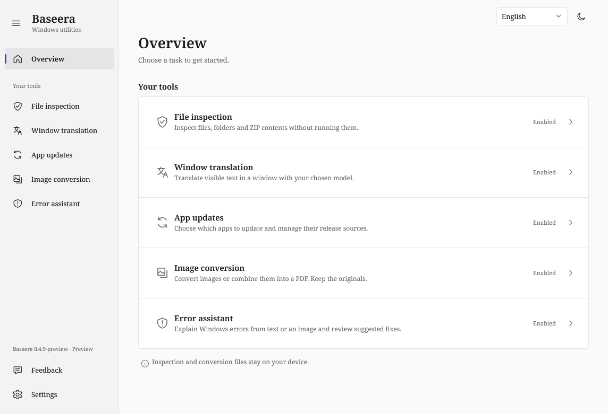

<details>
<summary>Dark appearance and Arabic RTL</summary>

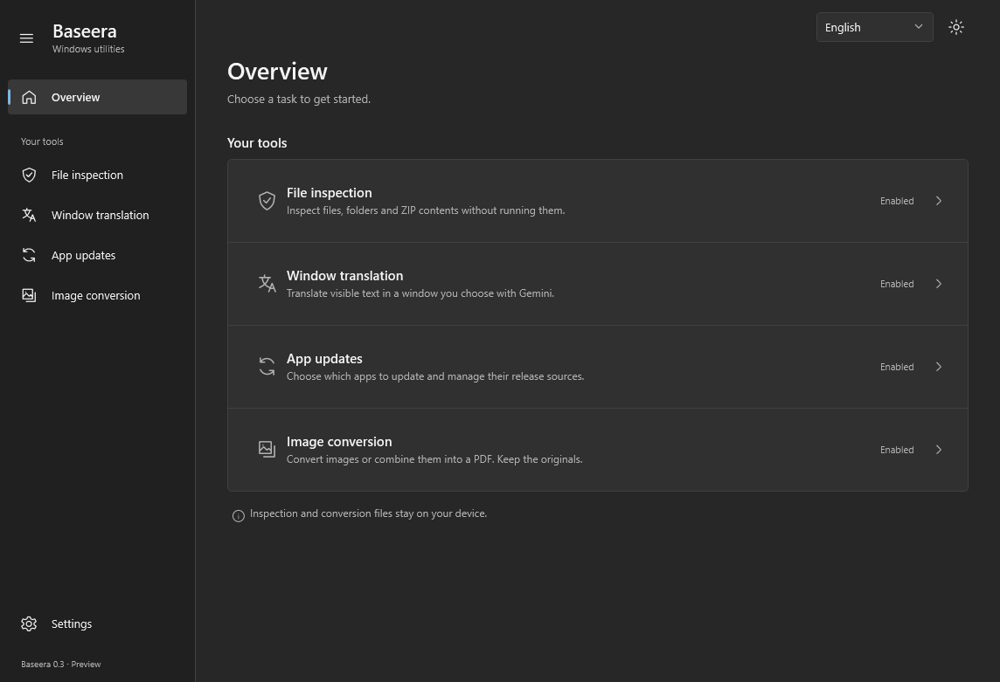
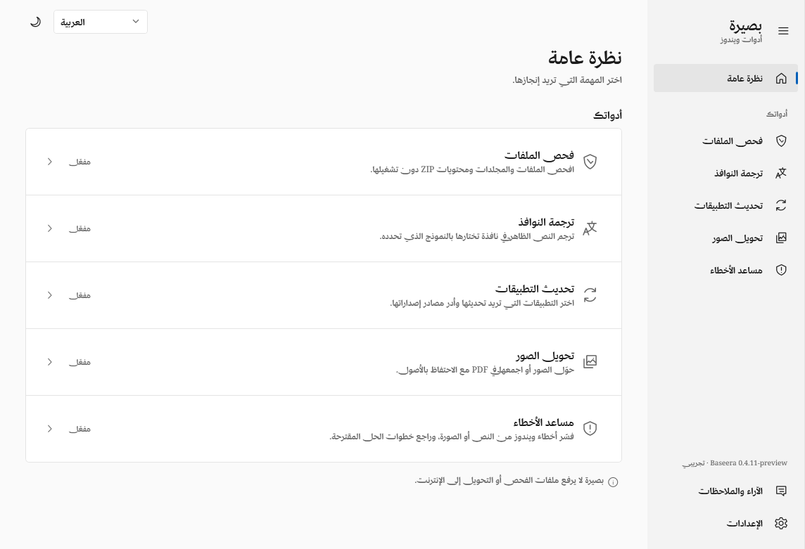

</details>

**Early preview, version 0.4.12.** This is a new project, not a certified antivirus
or a claim of 100% malware detection. Read the [capability status](docs/ROADMAP.md)
and [security scope](SECURITY.md) before relying on it.

## What works

| Tool | Current capability |
| --- | --- |
| File inspection | Files/folders, nested ZIPs, SHA-256, PE structure and script indicators. Reports skipped/encrypted/unsupported content explicitly. No execution or upload. |
| Window translation | Select an open window (including minimized apps), send its screenshot to your chosen image-capable model on request, and display translated text over the image. Esc closes the overlay. |
| Windows error assistant | Appears in Your tools on the Overview and sidebar. Paste an image directly or copy an image file, choose a file, or capture an open window; the image appears immediately. Enter error text and click Analyze for suggested steps. Reopen with Ctrl+Shift+E. |
| Page translation | Chrome/Edge extension replaces ordinary page text in place and restores originals. User-provided Gemini key and model. |
| App updates | Opt-in WinGet updates per package, at launch and every six hours while running. Manual per-app GitHub release URLs override automatic installation and show releases for review. |
| Baseera updates | Checks the official repository at launch and every two hours. In-app download, SHA-256 verification, same-path replacement and restart, with recovery backup. |
| Image conversion | PNG, JPEG, BMP, TIFF and ordered multi-image PDF. Preserves source files. Opt-in Explorer menu and Ctrl + right-click on selected images while running. |
| Interface | Arabic RTL, English, French, Spanish, light/dark themes, vector icons, collapsible navigation and first-run feature selection. |
| Feedback | An in-app form opens a prefilled GitHub issue for review and submission. Feedback sits above Settings in the sidebar. |

The 0.3 desktop refresh uses the native Windows caption for close, minimize,
maximize, system menu and resizing. A compact sidebar, monochrome icons, neutral
surfaces and task lists replace the previous artwork and colored dashboard cards.
Noto Serif is bundled for English and other Latin text; the supplied Arabic font
continues to handle Arabic and RTL. No system font installation is needed.
The translation and error pickers refresh when opened, show the number of open
windows, and include minimized apps and Baseera itself. Hidden, cloaked, helper
and off-screen windows are excluded. A minimized app is restored before capture.
The Settings shortcut jumps directly to
the translation service and focuses the missing key or model field.
Settings are grouped by purpose; unsaved translation settings survive appearance changes.

The error assistant can be enabled or disabled with the other tools in Settings.
When enabled, it also opens separately before the main window on a normal launch. If
no AI service is configured, it offers a setup form first; closing it lets you keep using
the app. Keys are protected by the local Windows account and shared with window
translation. Error text and the selected image are sent to the selected service only after you
press **Analyze error**. Review a full-window screenshot before sending: it may
contain private information. The response gives possible causes, checks and steps,
not a guaranteed repair; Baseera does not run suggested commands or change Windows
settings. The dialog does not open for Windows auto-start or file-conversion launches.

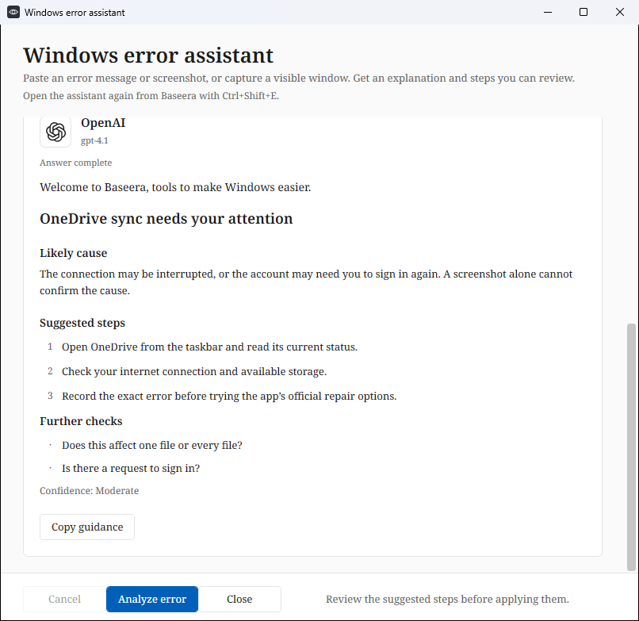

Answers show the selected service’s bundled logo and the exact model used for that
request. Validated guidance appears progressively at a measured pace, with **Show all**
for immediate reading. Arabic stays RTL, and Windows reduced-motion settings are
respected. Reanalysis or closing the window stops the previous animation.
[Presentation details and previews](docs/ANSWER-PRESENTATION.md).

Built-in Baseera instructions accompany every error-assistance request, with text
alone or a screenshot. The welcome sentence and all answer sections follow the
language of the user’s explanation, independently of the app’s four interface
languages. Other reply languages depend on the selected model’s language abilities.
[Prompt, language selection and limits](docs/ERROR-ASSISTANT-PROMPT.md).

Choose from **20 direct AI services**: Gemini, OpenAI (ChatGPT models), Claude,
Grok, Mistral, Cohere, Qwen, Z.ai, Kimi, StepFun, Together AI, Fireworks, Groq,
NVIDIA NIM, SambaNova, Nebius, DeepInfra, SiliconFlow, Novita and Hyperbolic.
Each service uses its own key and direct official endpoint. OpenAI also offers
**Continue with ChatGPT** below the provider: eligible accounts can sign in through
the official browser flow, choose an account model and save it without an API key.
The app keeps account sessions and API-key billing separate. OpenRouter is removed.
Load models from the chosen service and select from the image-capable list; no
model ID entry is required. Some services return a global catalog, so listed models
may still require account activation, regional access, quota or credit. Pricing
comes from service metadata; absent prices are marked account-dependent.
See [service endpoints, filtering and verification](docs/AI-SERVICES.md).

Connection controls are created once and updated in place to prevent the previous
service-switch crash. Model loading is cancelled when
the service/key changes, and obsolete replies cannot overwrite the current choice.
API-key billing remains separate from consumer chat subscriptions. The optional
ChatGPT account method uses the eligible plan or credits with consent and account
limits. Account choice, automatic session renewal, sign-out, a first-sign-in
confirmation and a Manage usage link are included. See [ChatGPT sign-in](docs/CHATGPT-SIGN-IN.md).

Version 0.4.12 fixes the empty connection panel when reopening **Change AI service**.
ChatGPT sign-out now disconnects the selected registration across open tools before
remote revocation, while keeping Baseera open and preserving API keys, model choices
and unsaved API-key drafts. It does not switch to API-key billing automatically.

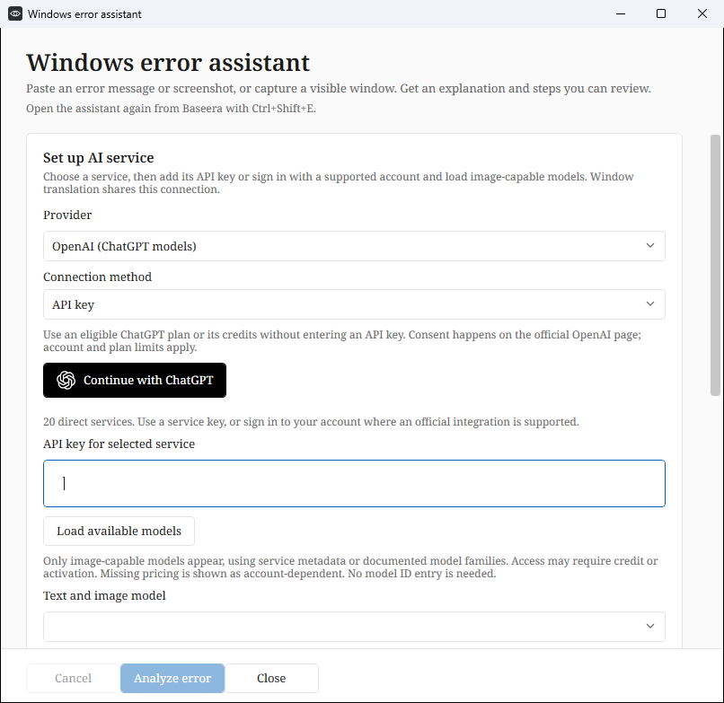

<details>
<summary>Error assistant in Your tools</summary>

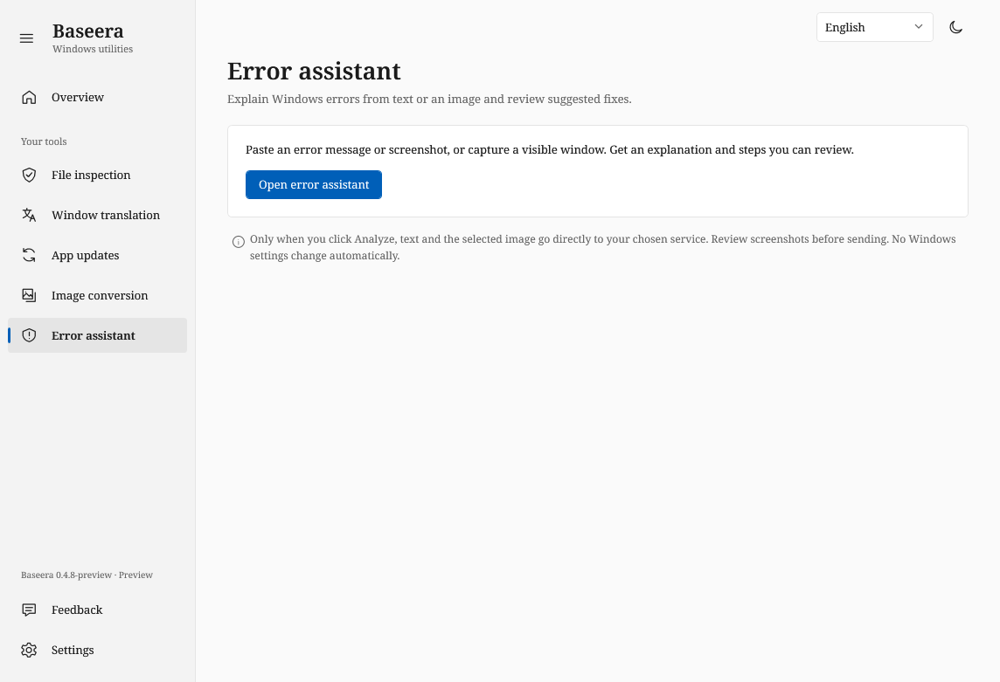
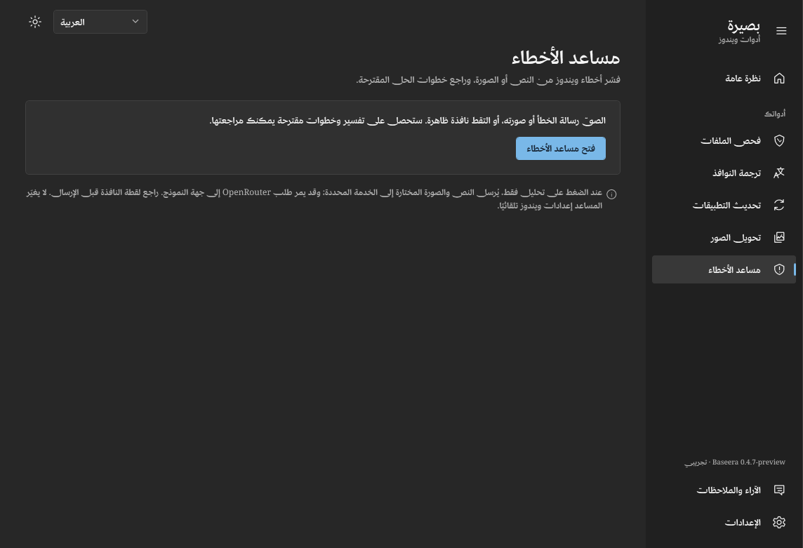

</details>

The Feedback page is above Settings. It opens a prefilled GitHub issue in your
browser; you review and submit it there. Long descriptions are copied to the
clipboard for pasting. Keys and screenshots are never attached automatically.

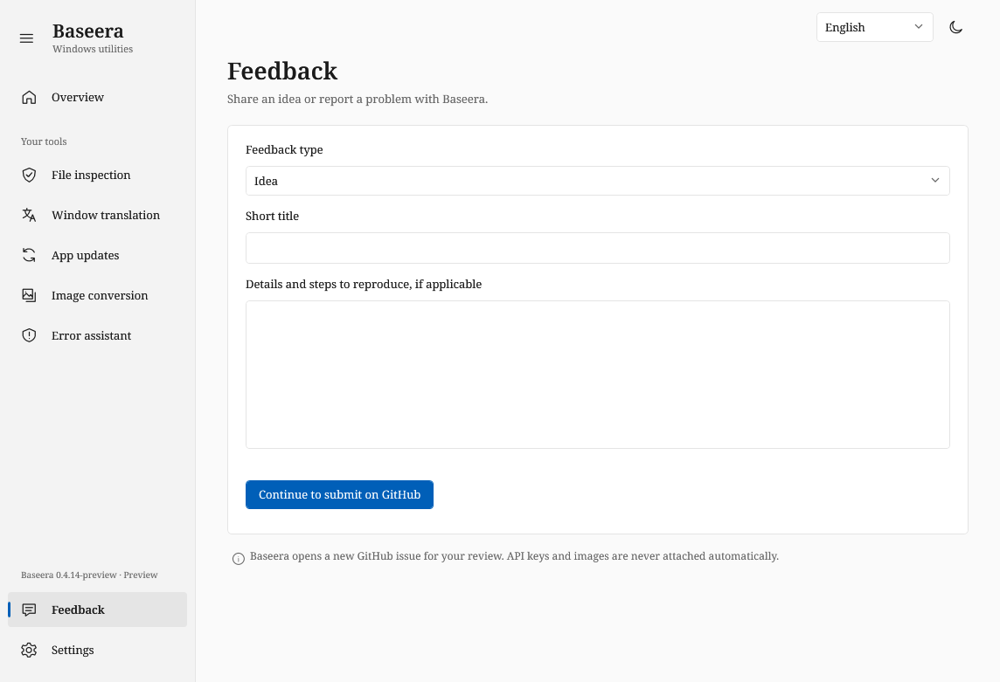

The app-update list shows locally resolved names, publishers, installed versions
and icons from application files or Windows packaged-app resources. Matching is
conservative: ambiguous/missing icons use a neutral symbol. Search by name, ID or
publisher, filter to selected apps, and expand a row to configure its release
source. The loaded list, choices and URL drafts survive navigation and appearance
changes. Refresh errors retain the previous list. Manual release URLs require
review and never run an installer automatically.

<details>
<summary>App-list preview (sample entries with actual local Windows icons)</summary>

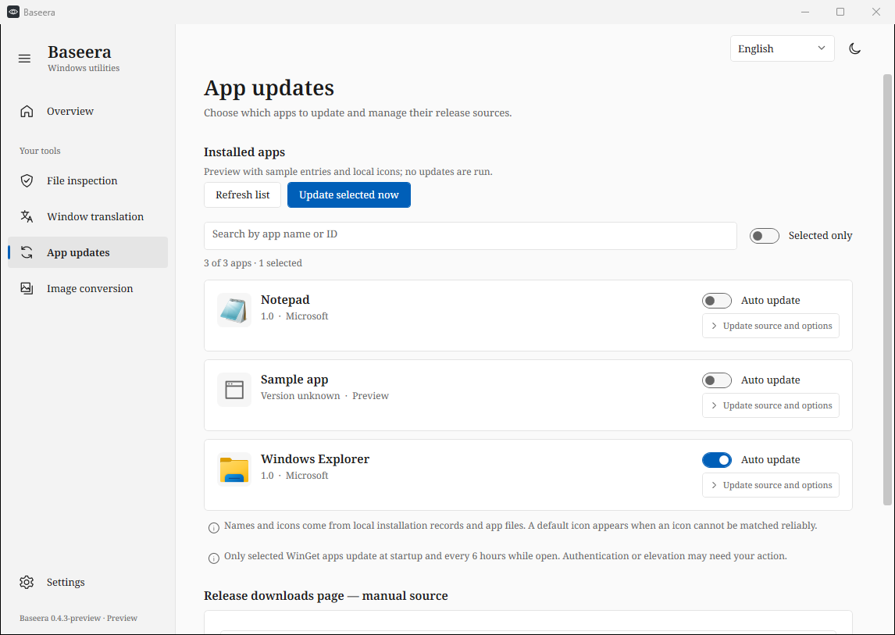
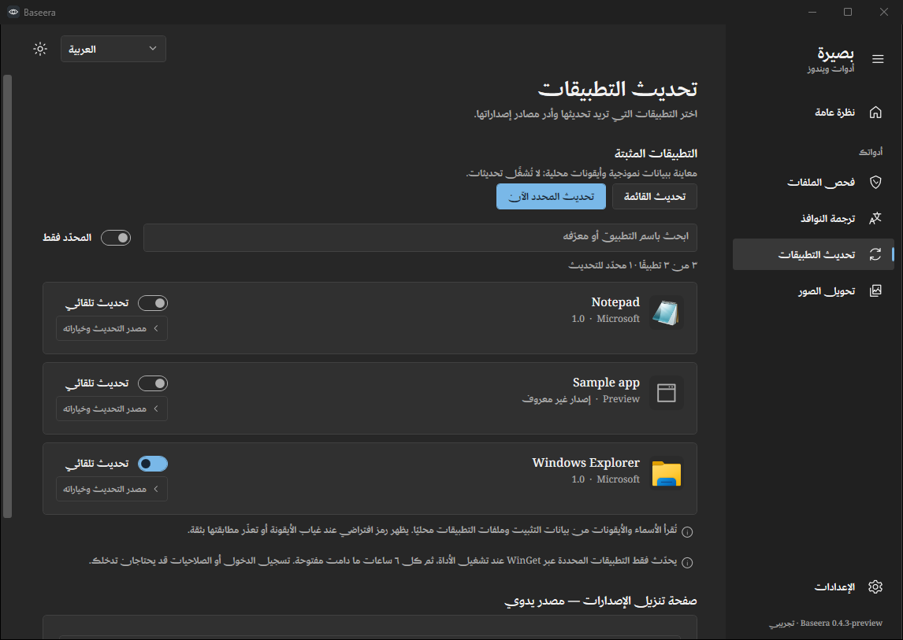

</details>

<details>
<summary>Tool pages and native window frame</summary>

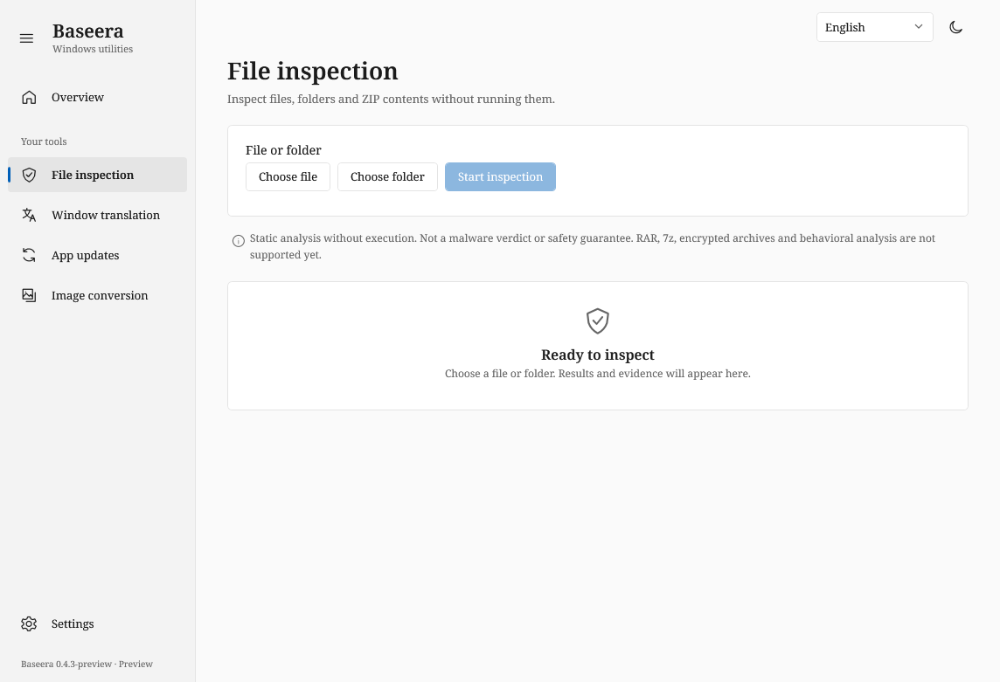
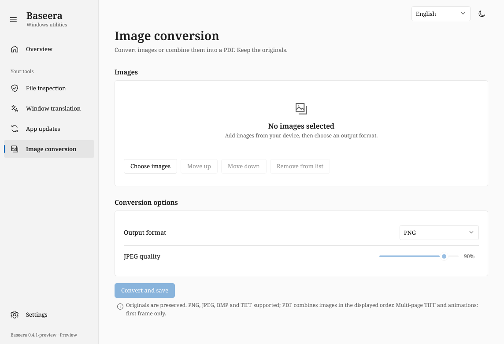
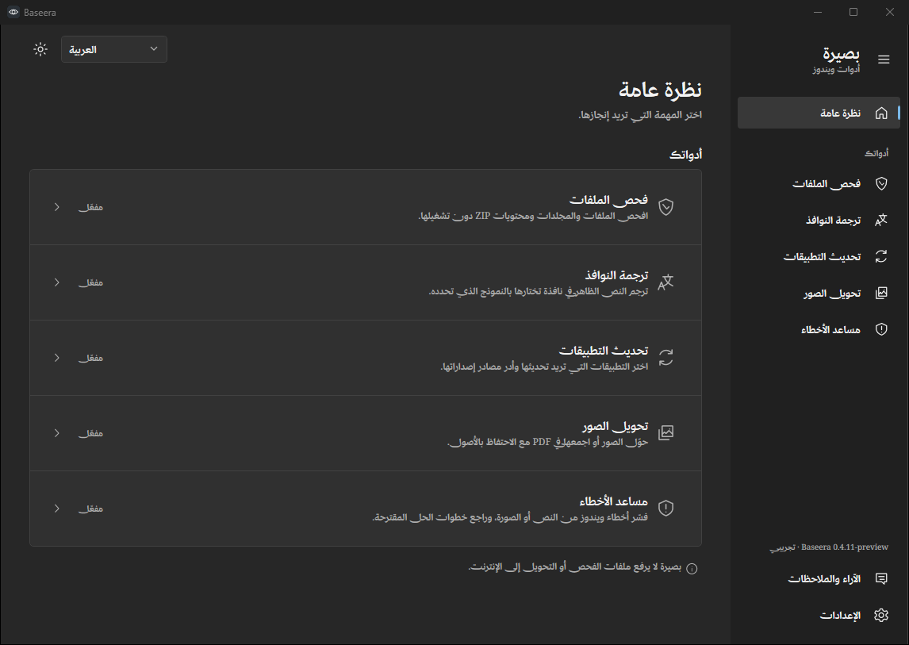
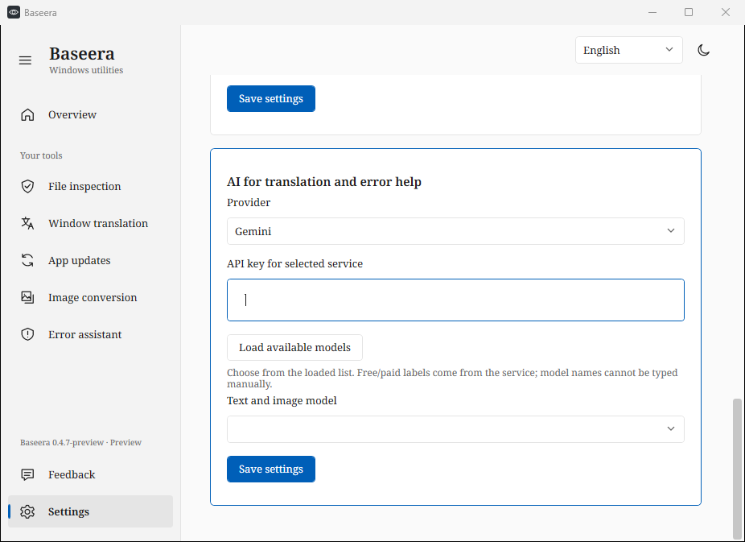

</details>

## Run

On first launch, a welcome dialog summarizes the five tools, explains translation
privacy and lets you choose the interface language and appearance. Continue to
tool selection to enable what you need. The dialog appears once per Windows
profile by default, including once for profiles upgrading from an older version.
You can select **Show this window at startup**, or reopen it from **Settings →
Appearance and language → Getting started**.

<details>
<summary>Welcome dialog</summary>

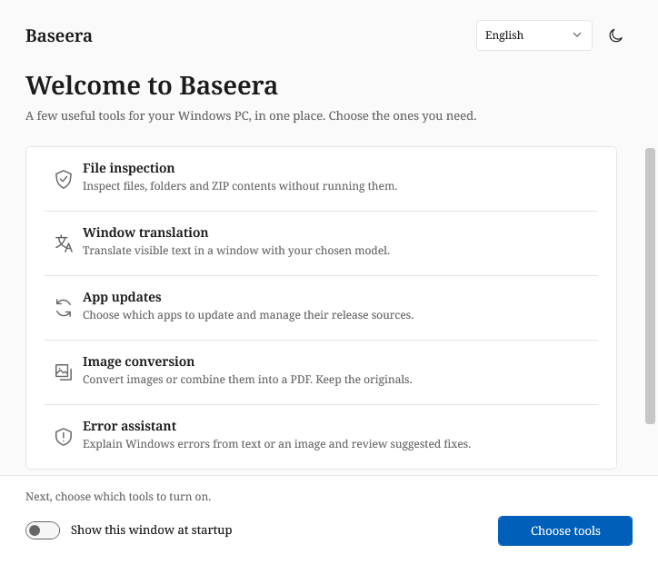
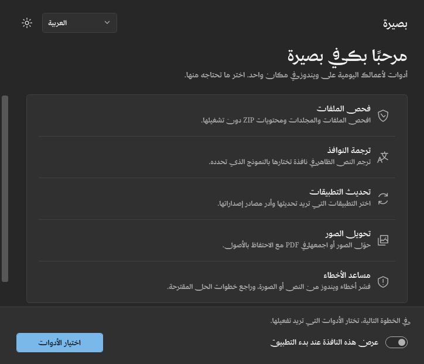

</details>

Requires **Windows 10/11, x64**. The runtime is included; no separate .NET installation is needed.

| Download | How to use |
| --- | --- |
| [Windows app (.exe)](https://github.com/yabs117/baseera/releases/download/v0.4.12-preview/Baseera-v0.4.12-Windows-x64.exe) | Save to a permanent folder and open it. This is the desktop application. |
| [Windows ZIP with instructions](https://github.com/yabs117/baseera/releases/download/v0.4.12-preview/Baseera-v0.4.12-Windows-x64.zip) | Extract the whole ZIP, then open `Baseera.exe`. |
| [Optional browser extension](https://github.com/yabs117/baseera/releases/download/v0.4.12-preview/Baseera-v0.4.12-Browser-Extension.zip) | Extract, read `START-HERE.html`, then load the inner `extension` folder in Chrome/Edge. |

Source ZIP downloads from GitHub are source code, not compiled applications.
The browser extension is installed **inside the browser**. Do not double-click its
module files. A Windows Script Host error means a source file was opened as a Windows script.

The four original desktop tools stay off until selected; the error assistant is
enabled by default and can be turned off in Settings. Startup registration and
Explorer integration are optional settings, applied only when you save them.

### Updating Baseera

Starting with **0.4.0**, Baseera checks its own official GitHub releases when opened
and every two hours while running. A new release opens a dialog with its version,
size and notes. Choose **Update and restart** to download inside Baseera, verify the
file, replace the current executable and reopen it at the same path. Your settings,
tool choices and saved Gemini key remain in your Windows profile. Unsaved settings
must be saved before updating. **Later** dismisses that version for this session.

Under **Settings → Baseera updates**, you can check manually or disable automatic
checks. These checks are independent of the optional WinGet app-update module.
They include this project's preview releases. Downloads start only after your click.

Keep the app in a writable, permanent folder and close other running copies before
updating. A background helper replaces the file after Baseera exits; no browser or
second installed application is opened. A backup is retained until the restarted
window loads, and restored if replacement or startup fails. Protected folders,
security software or a changed executable can prevent installation; recovery files
are retained if rollback itself cannot complete. Releases are currently unsigned.

Versions **0.3.1 and earlier** need one manual download of 0.4.0 to gain this updater.
The browser extension is still updated separately through the browser.

<details>
<summary>In-app update dialog (future-version preview fixture)</summary>

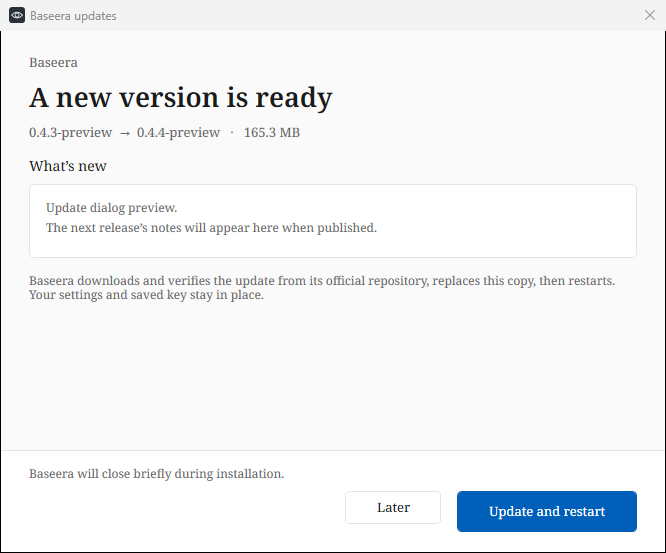
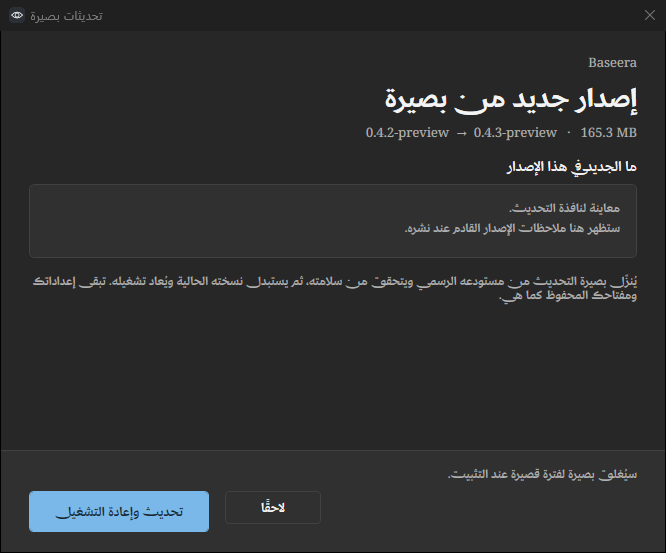

</details>

For translation and error help, choose your AI service and enter its own API key in Settings,
load the models returned for that key, and select one from the image-capable list.
For OpenAI, you can instead choose ChatGPT account, complete browser sign-in, load
its models and save the connection.
No key is bundled. Screenshots and error text are sent only on request to the
selected service. Local file inspection
and conversion do not use AI or send files.

## Build and verify

Install the .NET 10 SDK on Windows. There are no third-party NuGet dependencies.

```powershell
./build.ps1 -Test -Publish
# Optional desktop integration checks and renders:
./build.ps1 -Smoke
# Real replacement/restart and rollback on isolated copies (after -Publish):
./tests/self-update.e2e.ps1
# Browser extension protocol tests (Node 22+):
node --test extension/test/protocol.test.js
```

The self-contained executable is produced in `artifacts/Baseera-v0.4.12-Windows-x64/`.
`-Smoke -Publish` also checks the packaged executable. `-Smoke` uses a separate local data directory and does not run updates or
register Explorer hooks. It renders the actual WPF screens and tests conversion,
PDF generation, translation-box validation, localization coverage and DPAPI storage.
It also tests successful, corrupt, partial, canceled and redirected update downloads
without contacting the network. The standalone end-to-end check uses temporary
copies and isolated data, including a renamed executable and failed-start rollback.

## Browser extension

Extract the browser extension ZIP first. Open `chrome://extensions` or `edge://extensions`, enable Developer mode, choose
**Load unpacked**, and select the `extension` folder. Open an HTTP(S) page and click
the extension. Enter a Gemini key and model ID, choose the target language, then
translate. The extension key is separate from the desktop key and is kept only
for the browser session. It reads the current page after an explicit action, with
up to 300 segments / 30,000 characters per run. Inputs, editable fields, images,
iframes and closed shadow roots are excluded. New SPA content may require another run.

## Known limitations

- The scanner is bounded static inspection, not dynamic sandboxing or a full malware engine.
  Unsigned files and sensitive API references can be legitimate. RAR/7z are not supported yet.
- Vision translation depends on model output; coordinates and text can be wrong. It captures
  the visible screen region, so keep the target unobstructed. The overlay is a snapshot,
  not continuous tracking, and protected/fullscreen surfaces may not work.
- Live Gemini requests require a user key and quota. They were not exercised with a real
  API key during the initial local build. WinGet installs and Explorer hooks were not
  exercised against the developer's installed apps/files during automated tests.
- Manual update sources currently support GitHub Releases discovery, not unattended
  installation or arbitrary download-site scraping. Invalid manual URLs never fall back
  to automatic installation.
- Ctrl + right-click uses the current Explorer image selection while Baseera is running.
  The normal context menu entry lives under Windows 11's **Show more options**.
- TIFF/animated input uses only the first frame. WebP and office-document conversion are future work.

## Privacy and data

Preferences are stored under `%LOCALAPPDATA%/Baseera`. The desktop API key is encrypted
with Windows DPAPI. Conversion never overwrites an existing image output. PDF output
requires a new filename. Update logs stay local. No telemetry is built into Baseera.

Built with C#/.NET/WPF and a dependency-free Manifest V3 browser extension.
Arabic text uses the bundled Elgharib Hayyakum Allah Taweel font supplied by the project owner.
See [third-party notices](THIRD-PARTY-NOTICES.md) for its font license.
See [CONTRIBUTING](CONTRIBUTING.md), [ROADMAP](docs/ROADMAP.md), and the [MIT license](LICENSE).
