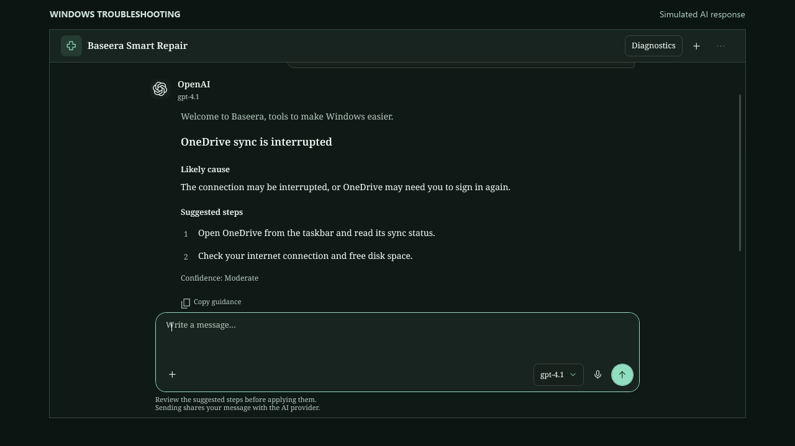

# Baseera

**Turn a Windows error into practical next steps.** Paste the error message or attach a screenshot. Smart Repair uses your configured AI service to explain likely causes and suggest checks you can review before making changes.

**[Download for Windows](https://github.com/yabs117/baseera/releases)** · [User guide](docs/USER-GUIDE.md) · [Welcome screen](#welcome-screen) · [Changelog](docs/CHANGELOG.md)

Windows 10 and 11 x64 · Preview releases · .NET included

**English** · [العربية](docs/README.ar.md) · [Español](docs/README.es.md) · [Français](docs/README.fr.md) · [简体中文](docs/README.zh-CN.md) · [繁體中文](docs/README.zh-TW.md) · [Tiếng Việt](docs/README.vi.md)

## Smart Repair in action

[Watch the 5.75-second video](docs/images/smart-repair-demo.mp4)

*Recorded in Baseera’s development build using a sample Windows error and a simulated AI response.* [How Smart Repair works](docs/SMART-REPAIR.md)

Baseera also translates Windows app text, inspects files and ZIPs locally, manages updates for selected apps, and converts images or combines them into a PDF. [Explore the tools](docs/USER-GUIDE.md)

## Welcome screen

*6.5.0 development preview*

## Overview

*Sample device readings*

## Privacy and data

File inspection and image conversion stay on your device. AI features send requests to the service you configure. Baseera's automatic update checks can be turned off in Settings. [Privacy Policy](PRIVACY.md)

[Build from source](docs/BUILD.md) · [Contribute](CONTRIBUTING.md) · [MIT license](LICENSE)
