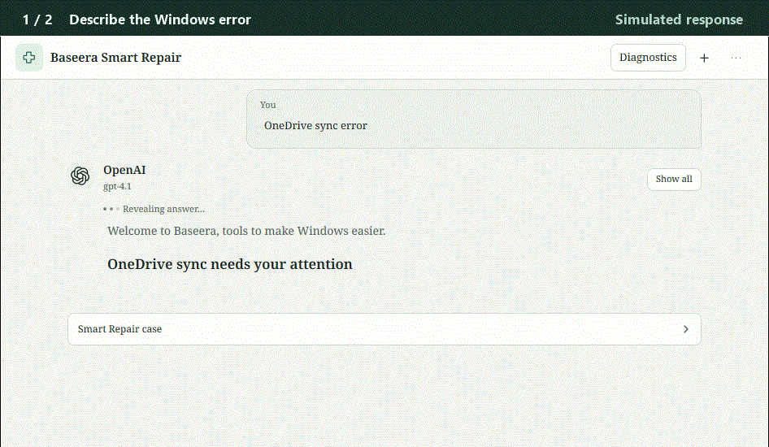
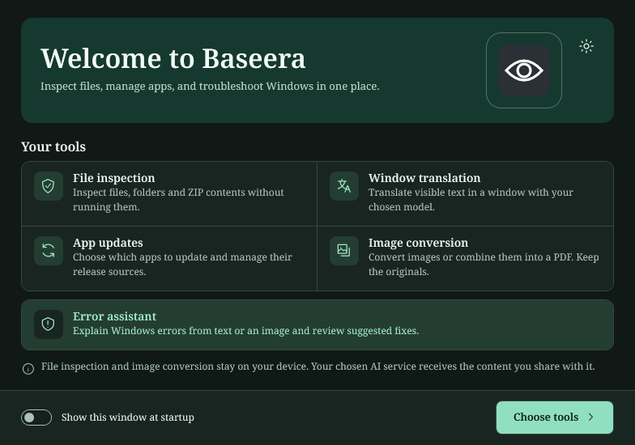
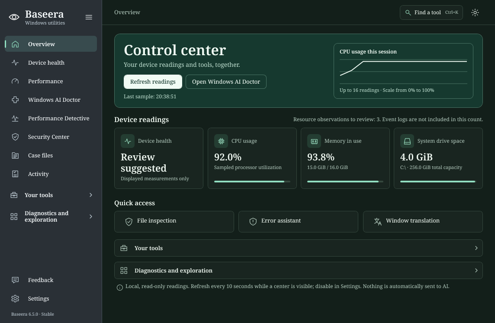

# Baseera

undefined**[Download for Windows](https://github.com/yabs117/baseera/releases)** · [User guide](docs/USER-GUIDE.md) · [Welcome screen](#welcome-screen) · [Changelog](docs/CHANGELOG.md)

Windows 10 and 11 x64 · Preview releases · .NET included

**English** · [العربية](docs/README.ar.md) · [Español](docs/README.es.md) · [Français](docs/README.fr.md) · [简体中文](docs/README.zh-CN.md) · [繁體中文](docs/README.zh-TW.md) · [Tiếng Việt](docs/README.vi.md)

## Smart Repair in action

*Baseera development build with a sample Windows error and a simulated AI response.* [How Smart Repair works](docs/SMART-REPAIR.md)

Baseera also translates Windows app text, inspects files and ZIPs locally, manages updates for selected apps, and converts images or combines them into a PDF. [Explore the tools](docs/USER-GUIDE.md)

## Welcome screen

*6.5.0 development preview*

## Overview

*Sample device readings*

File inspection and image conversion stay on your device. AI features use the service you configure and send the content you choose to share. Repair actions require your approval.

[Build from source](docs/BUILD.md) · [Contribute](CONTRIBUTING.md) · [MIT license](LICENSE)
