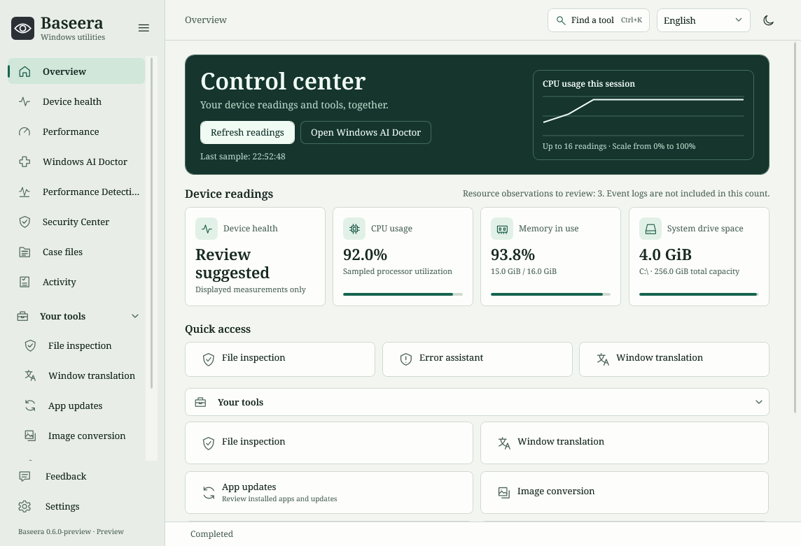

# Baseera

An open-source toolkit for everyday Windows maintenance and troubleshooting.

- **A suspicious download or a Windows error?** Inspect files and ZIPs locally, or ask Smart Repair to explain an error from text or a screenshot and suggest next steps.
- **An app in a language you don’t read?** Translate the text in the Windows window you choose.
- **Routine maintenance piling up?** Manage updates for selected apps and convert images or combine them into a PDF from the same toolkit.

**[Download for Windows](https://github.com/yabs117/baseera/releases)** · [User guide](docs/USER-GUIDE.md) · [Changelog](docs/CHANGELOG.md)

Windows 10 and 11 x64 · Preview releases · .NET included

File inspection and image conversion stay on your device. AI features use the service you configure and send the content you choose to share. Repair actions require your approval.

[العربية](docs/README.ar.md) · [Français](docs/README.fr.md) · [Español](docs/README.es.md) · [Build from source](docs/BUILD.md) · [Contribute](CONTRIBUTING.md) · [MIT license](LICENSE)
