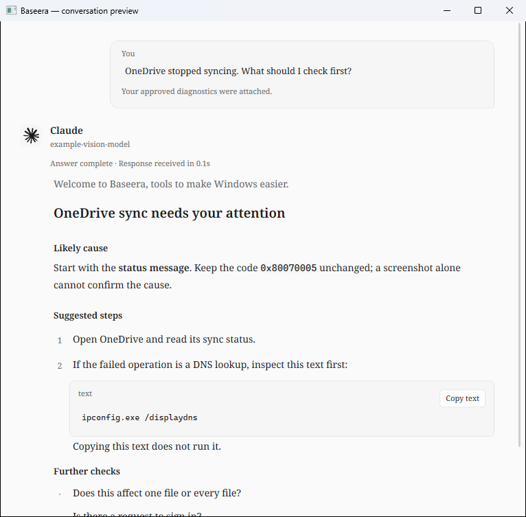
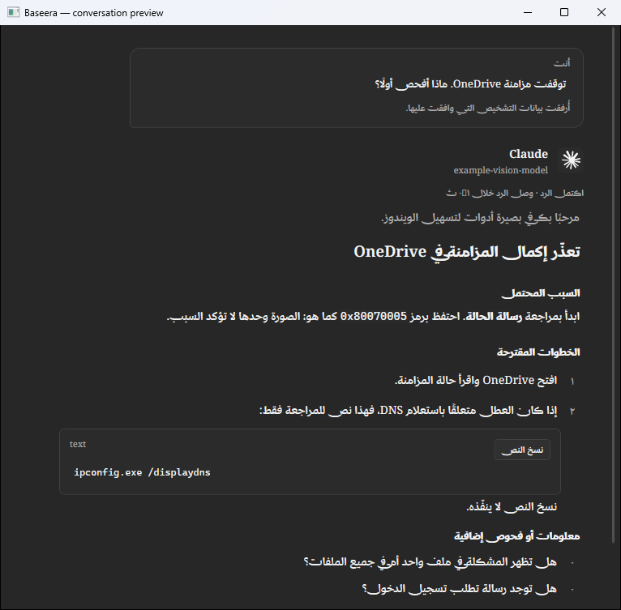

# Error-assistant conversation presentation

The 0.4.15 development preview presents each analysis as a submitted-message/answer
exchange. The message is an immutable snapshot of the submitted text, selected image
thumbnail and whether approved diagnostics were attached. Long messages collapse
behind **View submitted message** without truncating the submitted text. This is
now a [continuous conversation](CONVERSATIONS.md): bounded recent text is included
for the same recipient, while media bytes and private diagnostic snapshots are not
automatically resent. The composer remains at the bottom of the window.

The answer uses the selected service's existing bundled vector mark, service name
and request-scoped model ID, followed by an unboxed, readable response. All twenty
services share the same layout. Waiting status means the app is waiting for the
service; it does not fabricate an agent's reasoning or progress. The received-time
label measures elapsed local request time, not provider compute or token generation.

After a complete validated JSON answer arrives, text is progressively revealed at
52 grapheme clusters/second, accelerated for long answers to about 32 seconds of
active reveal time. This is presentation animation, **not network token streaming**.
Arabic marks, combining accents and joined emoji remain intact. Selecting an active
answer pauses reveal so the selection is retained; clearing it resumes. **Show all**
finishes immediately. Reduced-motion preferences disable reveal animation. Closing,
canceling or replacing a request detaches its timer and ignores late answers.

Read-only text supports mouse selection and normal copy shortcuts. The small
formatter supports paired bold markers, inline backticks and fenced text/code
blocks; other HTML, XAML, Markdown links and incomplete markers remain plain text.
It never creates remote images, navigable hyperlinks, executable controls or shell
commands. Fenced code normalizes CRLF to LF, stays LTR inside RTL prose and has an
independent copy button, enabled only when that block has finished revealing.
Copying never runs a command. The separate Smart Repair catalog and per-command
approval/UAC boundaries remain in force.

The full-response copy action includes the greeting, summary, cause, steps, checks
and qualified confidence, preserving source markup. Conversational replies use
natural prose and omit diagnostic headings; only the first reply shows the welcome.
Repair recommendations and case
follow-up appear after reveal finishes; the follow-up section is collapsed until
opened or a command attempt is recorded. The current sidebar, source selection,
four interface languages and reply-locale detection remain in use.

## Verification

`./build.ps1 -Test` exercises inert markup parsing, malformed delimiters, Unicode,
input bounds and the existing core/security checks. `./build.ps1 -Smoke` includes
the conversation suite. `--smoke <output> --advice-only` runs only its fixture UI
checks. Tests render all twenty services in both themes, four interface languages,
RTL prose with LTR code, submitted-message identity, image thumbnails, selection,
pause/resume, fake-clipboard exact-copy behavior and lifecycle/reduced-motion cases.
The full suite also checks fifteen reply locales independent of the interface.
No live model request, command execution or clipboard modification is needed by
these conversation tests. Preview screenshots contain fixtures only.

