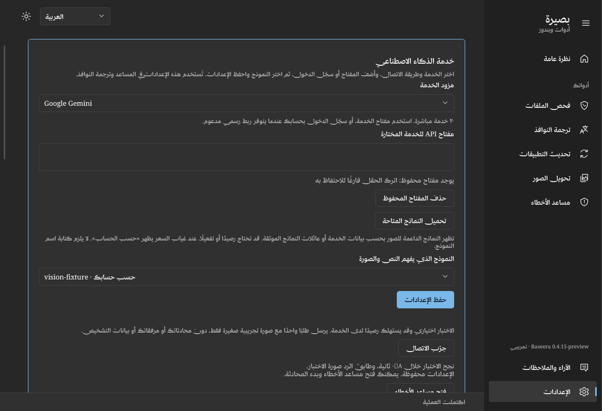
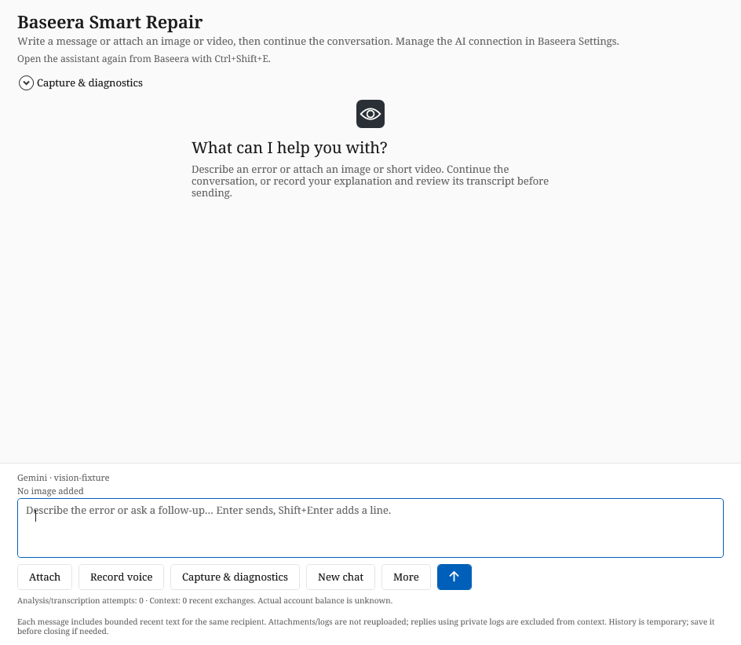

# AI setup in Settings — development 0.4.15

The existing **Settings → AI service** card is the single place to configure the
connection used by Smart Repair and window translation. The sidebar and other
tools keep their current layout. The published 0.4.14 release does not yet include
this change.

1. Choose one of the twenty direct services. For OpenAI, select an API key or the
   existing eligible ChatGPT sign-in flow. Other services retain their own keys.
2. Load the available image-capable models and choose a model. No model ID typing
   is required. Catalog visibility alone does not establish access, quota or credit.
3. Save the settings. Keys remain protected with the current Windows user's DPAPI;
   the saved key is not displayed in the password box. Provider drafts remain separate.
4. Optionally select **Test connection**. The test can also check a valid unsaved
   draft; testing does not save it. Save before opening the assistant with that draft.
5. Select **Open error assistant** and start chatting. Its bottom composer shows
   the saved service/model as read-only text. It contains no provider, key, account
   or editable model setup form.

The test sends one fixed text instruction and a generated **64×64 JPEG** containing
one randomly selected solid color. It asks the selected model to identify that color.
It sends no conversation history, diagnostic preview, personal screenshot, video,
recording or file. It never captures the screen or microphone. ChatGPT sign-in tests
the explicitly selected draft account; it does not substitute the globally saved account.

The test is an explicit inference request and **may consume provider credit or plan
usage**. It is not automatically triggered by loading Settings, saving, changing a
provider/model, loading a catalog or opening the assistant. It has a 35-second
deadline, a cancel action and no automatic retry. It is separate from the
conversation's local ten-request checkpoint; that counter is not a spending cap.

## Results and state

- **Passed:** a response arrived and matched the generated test image. The elapsed
  time measures the local request. One matching answer is not proof of general
  visual understanding, diagnostic accuracy, future availability or account balance.
- **Response received, image not confirmed:** the service replied but the answer
  did not match. Check image capability; this is not labeled a successful vision test.
- **Failed / timed out / canceled:** settings remain available for correction and
  another explicit attempt. Arbitrary service response bodies and credentials are
  not echoed in the test status.
- Provider, key, account, authentication mode or model changes invalidate a pending
  result. Leaving the page cancels the test. Late responses cannot mark a different
  connection as tested. Success is temporary and is not persisted as an account-health claim.
- **Open error assistant** is available only when the form matches the saved usable
  connection. An unsaved draft cannot silently open a different saved provider.

If no usable connection is saved, opening Smart Repair routes to the relevant field
in main Settings. The assistant's **More → Settings** action temporarily hides the
assistant, opens/focuses the same card and preserves the current temporary chat,
draft and attachments. **Open error assistant** returns to that same window.
Settings navigation is blocked during an active upload, recording or repair; stop
or finish it first. Existing recipient isolation still applies: changing provider,
API key or account does not transfer an old thread's text without the new-thread
confirmation. Signing out clears that account globally, cancels its in-flight
inference and disables Send without closing the whole app or altering other keys.

## Verification

`build.ps1 -Smoke` includes the fixture suite, or run the isolated executable with
`--smoke <output> --ai-settings-only` after setting `BASEERA_DATA_DIR` to a disposable
test directory. `ai-settings-result.txt` records the result.

Checks cover the twenty provider payloads, fixed synthetic image, explicit draft
ChatGPT account, nonmatching response, HTTP failure, cancellation, stale provider/key
results, unsaved/tested/saved state, four interface languages, missing-setup routing
and the same-window return preserving a conversation, image and draft. Existing
global sign-out regression coverage stays in the full suite. All requests use fake
HTTP or injected probes: no paid request, real login or Windows repair is performed.

