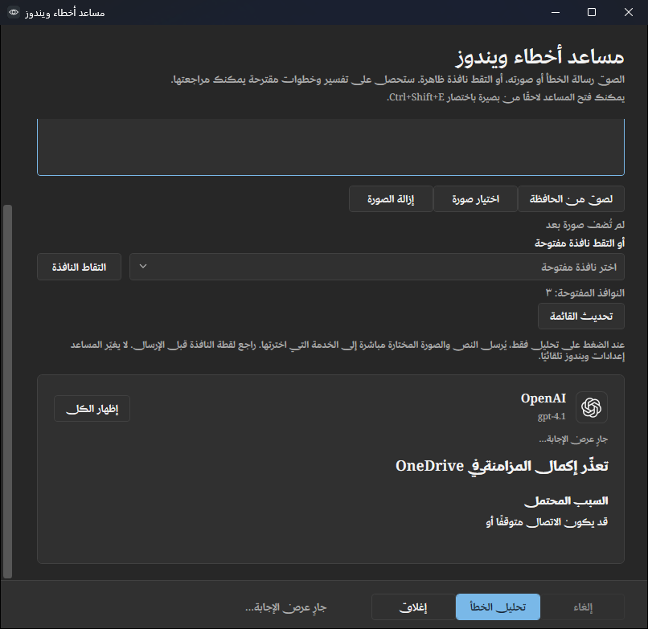
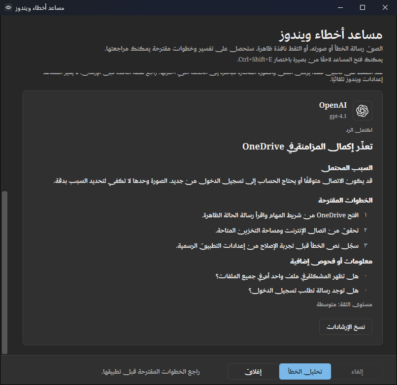

# Error assistant answer presentation

Baseera 0.4.10 keeps the existing application layout and adds a response card to
the Windows error assistant. It identifies the responding service with a bundled
monochrome logo and shows the selected model ID. The identity is captured when the
request starts, so changing connection settings cannot relabel an earlier answer.
All twenty services have local SVG assets, pinned to the source and license recorded
in `src/Baseera.App/Assets/Brand/Providers/SOURCE.md`. Displaying a logo makes no
network request and sends no credentials or error information to an image host.

## Progressive display

After the complete structured response passes validation, the summary, probable
cause, suggested steps, further checks and confidence appear progressively. This is
a local presentation effect, not live token streaming. It never reveals unfinished
JSON or an incomplete API response as valid advice.

The ordinary pace is 52 Unicode text elements per second; longer responses adapt
to finish within approximately 32 seconds, excluding UI scheduling delays. The
**Show all** button makes the entire answer available immediately. If Windows
client-area animations are disabled, the answer appears immediately. Controls stay
responsive throughout the reveal.

Text element boundaries preserve Arabic diacritics, combining accents and joined
Unicode characters. Arabic content follows the existing RTL layout, while model
IDs and the logo itself remain LTR. Sections and numbered steps use clearer spacing.

The viewport follows the growing answer when you are at the bottom. Scrolling upward
pauses this following behavior, allowing you to review earlier content. A new
analysis starts a new response card and stops the old timer. Cancellation removes
the waiting response; closing disposes the timer and ignores late request results.
Copy becomes available once the reveal finishes, including when Show all is used.
It includes every returned section, including further checks and confidence.

## Verification

The UI smoke suite checks all twenty local marks in both themes, request-specific
identity, four-language rendering, RTL, actual partial display before completion,
Unicode boundaries, Show all, natural completion, reduced motion, replacement,
cancellation, closing and late replies. Screenshots use sample advice and fake AI
responses; no live AI request or real credential is needed for these checks.

Implementation references:

- [WPF DispatcherTimer](https://learn.microsoft.com/en-us/dotnet/api/system.windows.threading.dispatchertimer)
- [Windows client-area animation preference](https://learn.microsoft.com/en-us/dotnet/api/system.windows.systemparameters.clientareaanimation)
- [Unicode text elements](https://learn.microsoft.com/en-us/dotnet/api/system.globalization.stringinfo.parsecombiningcharacters)
- [Lobe Icons and license](https://github.com/lobehub/lobe-icons/tree/7d7d0379f18b114a4009dc5cb85a7c375284f31b)
