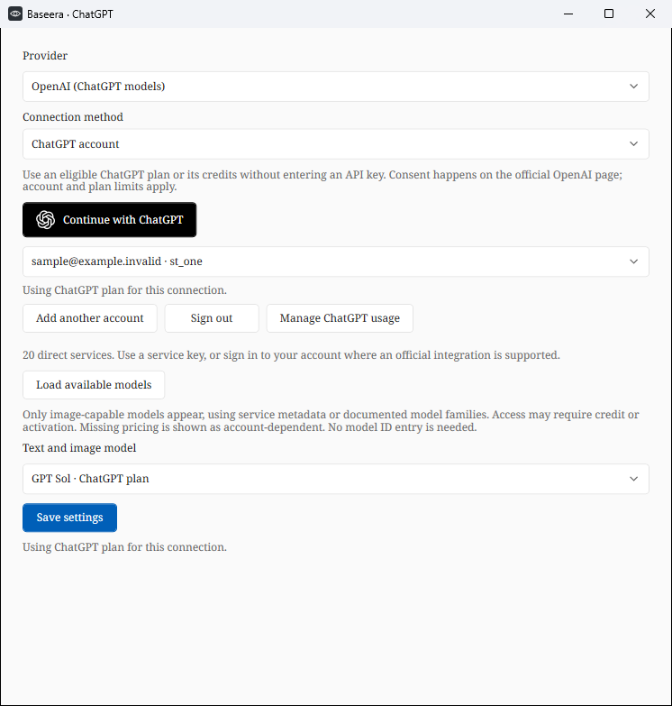

# Sign in with ChatGPT

Baseera 0.4.9 adds the official **Continue with ChatGPT** flow to the Windows app.
Select OpenAI in Settings or the error assistant's connection form, then choose
ChatGPT account or click Continue with ChatGPT below the provider. No API key is
needed for this connection method.

1. Complete sign-in and consent on OpenAI's page in the system browser.
2. Return to Baseera. The first successful plan-enabled sign-in explains plan usage.
3. Load the account's image-capable models, choose one, then save settings.
4. Error assistance and window translation use that saved account and model.

An eligible ChatGPT plan, permission to use it, and available account/app usage are
required. Sign-in does not guarantee unlimited or free requests. Use **Manage ChatGPT
usage** to review access and limits in ChatGPT settings. Baseera has no paid app plan.

## Accounts and keys

The account picker keeps registrations separate, including registrations with the
same email in different workspaces. Continue with ChatGPT reauthorizes the selected
registration; Add another account starts a new one. Account and model choices become
active when settings are saved. The API-key method remains available independently.

Stored OAuth credentials never overwrite the OpenAI API key. If a session expires,
is revoked, or reaches a usage limit, Baseera asks for reconnection or directs the
user to usage settings. It does not silently fall back to API-key billing.

From 0.4.13, Sign out cancels requests and removes the selected registration from
Baseera’s local account store, including its saved name, email, subject, client ID
and credentials. Every open picker and connection draft removes that profile, and
the selected account/model are cleared before remote revocation is attempted.
A notice in the error assistant offers to close that assistant window. Baseera
stays open; reopening the assistant cannot restore the removed account.

Saved API keys, API model choices, other open API drafts and unrelated registrations
are preserved. There is no automatic API-key billing fallback. The remote revocation
attempt is bounded to twenty seconds. If it cannot be confirmed, the profile is
still removed locally and the notice explains how to disconnect Baseera in ChatGPT
settings. This does not delete the user’s OpenAI account or sign their browser out.

At startup, legacy profiles left by older sign-outs are pruned only when all access,
refresh and ID tokens are empty. Identity-only sign-ins still holding credentials
are not treated as signed out. The opaque installation host ID is preserved; it
does not display an account name or email. Signing in again after removal starts
a new registration through the official flow.

This release offers consumer-account sign-in for **OpenAI/ChatGPT**. The other
19 direct-service adapters continue to use their own API keys. In particular, the
Claude adapter does not expose a Claude consumer-account sign-in button. The optional
browser extension keeps its separate Gemini API-key setup.

## Protocol and storage

- Uses OpenAI's documented OSS dynamic registration, the real app name Baseera,
  a stable UUIDv4 host ID, fresh state/nonce, PKCE S256, and a loopback-only listener.
- Starts the listener before launching the browser. The redirect is always
  `http://127.0.0.1:<available-port>/auth/callback`; the code exchange uses the exact
  same URI. Duplicate query fields and mismatched state/client IDs are rejected.
- Retains the issued client ID for a fresh authorization after `invalid_grant`.
- Validates the ID token with OpenAI's JWKS using RS256, issuer, audience, expiry,
  nonce and account identity. Checks granted plan-use scopes separately from identity.
- Stores identity and credentials atomically in `chatgpt-accounts.bin`, protected by
  the current Windows account using DPAPI. Tokens and authorization URLs are not logged.
- Serializes rotating refreshes across threads/processes. Authenticated HTTP clients
  do not follow redirects, and discovered authorization endpoints must remain on
  OpenAI's authentication host.
- Loads the selected account's `/v1/models` catalog, preserves its ordering and
  listed visibility, and filters for image understanding.
- Sends images/text to the public `/v1/responses` endpoint with `store:false` and
  `stream:true`, omitting unsupported plan-usage fields. Success requires the terminal
  `response.completed` event; partial, interrupted and failed streams are rejected.

## Verification and limits

Automated tests use generated RSA keys, a real local HTTP callback listener, and
fake OpenAI HTTP responses. They cover PKCE/state, invalid-grant recovery, token
validation, encrypted storage, two registrations with the same email, model
filtering, rotating refresh concurrency, an image analysis request, streaming
completion/failure, API-key separation, four-language controls, and revocation.
These checks do not sign in to a real customer account or make paid inference calls.
Live availability and eligibility are decided by OpenAI when the user signs in.

Official sources checked for this integration:

- [Registration and sign-in](https://developers.openai.com/siwc/token-sharing-open-source/sign-in)
- [Accounts, refresh and revocation](https://developers.openai.com/siwc/token-sharing-open-source/profiles-and-sessions)
- [Models and inference](https://developers.openai.com/siwc/token-sharing-open-source/models-and-inference)
- [Preview request requirements](https://developers.openai.com/siwc/token-sharing-open-source/preview-limitations)
- [UI/UX guidelines](https://developers.openai.com/siwc/ui-ux-guidelines)
- [Claude API authentication methods](https://platform.claude.com/docs/en/manage-claude/authentication)
