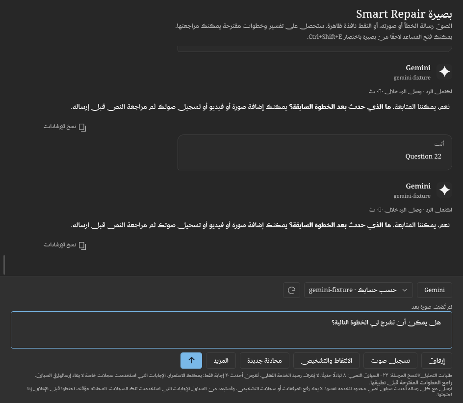

# Continuous Smart Repair conversations — development 0.4.15

The existing error assistant now keeps a conversation rather than replacing its
last answer. The composer stays at the bottom; **Enter** sends, **Shift+Enter**
adds a line. The current service/model can be changed through the existing service
settings and an inline vision-model picker. Opening the model picker loads that
recipient's available models; there is no manually invented catalog or assumption
that every account has access. Model lookup itself is not an inference request.

Follow-up requests include recent text as bounded, lower-trust JSON context through
the existing twenty provider adapters. A normal explanation/greeting can use a
natural conversation response rather than mandatory diagnostic headings. A diagnosis
still has evidence limits and the original catalog-only repair approval boundary.
The welcome is shown on the first reply, rather than repeated on every follow-up.
The next request can also include the current case's last five canonical local
command results and two explicitly user-reported observations, without raw logs.
An exit code or observation is not independent proof of a repair.

## History and privacy

- There is no fixed total-turn limit. To bound memory, the window retains the
  latest **20 completed exchanges**, plus a pending request. The next request uses
  at most **8 recent complete exchanges / 24,000 UTF-16 characters**. Complete
  exchanges that do not fit are omitted. This is not unlimited model memory.
- Each turn sends only its newly selected image/video. Previous media bytes are
  not silently uploaded again. Prior textual answers may describe those media.
- Raw diagnostic previews still require separate, one-request approval. Exchanges
  that used private diagnostic logs are excluded from subsequent conversation
  context, so their echoed answers do not bypass that consent. Reapprove relevant
  diagnostics if a follow-up needs them. App-recorded command IDs/exit codes and
  explicit user observations are distinct from private diagnostic logs.
- Context is bound to service, authentication mode and the selected ChatGPT account
  or API-key fingerprint. Changing recipient requires starting a new local thread;
  prior text is not transferred. A model change within the same recipient can
  continue the same text context. Signing out purges that account's local thread.
- History is window-scoped and memory-only. **New chat** confirms clearing it.
  **More → Save conversation** explicitly writes a best-effort-redacted JSON file
  of the latest twenty exchanges. It includes no screenshot/video/recording bytes,
  raw log snapshots, stored credentials or account identifiers. Review before sharing.
  Closing discards the temporary thread. This version does not promise a permanent
  archive of every past message.
- A failed/canceled request restores its draft/attachment if no newer draft exists.
  It does not retry automatically or overwrite a newer question. Sign-out does not
  restore the old account's pending draft.

## Ten-request usage checkpoint

After every **10 attempted analysis/transcription requests**, the next billable
action is blocked until the user explicitly allows another batch. A visible notice
offers Continue or Stop; allowing continuation alone sends nothing. Failed or
canceled attempts are counted conservatively because a provider may already have
processed them. Catalog lookups and local recording/video sampling do not count.

This is a local request counter, **not a billing meter, token estimate, spending
cap or balance lookup**. Images, native video, audio and context can have different
costs; an account may run out before ten requests. The selected service's billing
page remains authoritative. No hidden summarization, background inference,
automatic retry or automatic follow-up is used to maintain conversation history.

## Images and video

Images retain the existing paste/file/capture workflow and normalization, stripping
image metadata before transmission. Use **Attach → Choose video** or drop one local
video file. The app accepts MP4, WebM, WMV, AVI and MOV only when the installed
Windows media decoder can open them. Clips are bounded to **12 MB, 60 seconds and
20 megapixels per frame**, with a cancelable preparation deadline. Windows N
editions or missing codecs can require installing the relevant Windows media
components; unsupported decoding produces an error, not an invented preview.

- With Gemini, Send uploads the **original clip including audio and container
  metadata**, with an explicit pre-send description. It is sent inline once;
  no persistent provider Files API upload or remote URL fetching is used.
- With the other existing vision adapters, Send uploads a normalized **contact
  sheet of six approximate samples**, with time labels. It does not upload the
  original video or its audio. The model is told that motion between samples and
  speech are unavailable; a short transient error can be missed. Attach a clear
  screenshot when exact text is important.

The Windows decoder and bounded file reads operate locally before Send. This is
not a hardened sandbox for hostile media. The size/duration limits intentionally
keep one-off inline requests small; they do not guarantee a particular API price.

## Voice input

**Record voice** starts an explicit local microphone capture. It uses the default
Windows input device through WinMM, mono 16-bit PCM at 16 kHz, bounded to **120
seconds**. A visible elapsed-time indicator and Stop control remain available.
Nothing is uploaded while recording or merely stopping. Recording requires a
working microphone and Windows privacy permission; failures remain recoverable.
The recording is kept in memory, can be played/discarded and is released on close.
No speech detection or fabricated volume waveform is displayed.

**Transcribe recording** requires another explicit upload confirmation. Direct
transcription is implemented only for:

| Selected connection | Transcription path |
| --- | --- |
| OpenAI API key | `/v1/audio/transcriptions`, `gpt-transcribe` |
| Groq API key | `/openai/v1/audio/transcriptions`, `whisper-large-v3-turbo` |
| Gemini API key | Selected Gemini `generateContent` model with inline WAV and a transcription-only instruction |

Only that recipient's own key/endpoint is used, with redirects disabled. The text
is placed in the composer for review/editing; transcription does **not** auto-send
it to the conversation. Sending the reviewed text is a separate counted request.
Transcription availability, accuracy and billing remain subject to the account.

ChatGPT sign-in and the other services are not passed through these API-key audio
endpoints. **More → Windows dictation** focuses the composer and opens Win+H as an
alternative independent of the AI service. Windows manages its speech/privacy
settings, supported languages and internet requirements. This does not submit the
draft automatically. Recorded-file transcription is voice **input**, not a live
voice-to-voice call or spoken assistant response.

## Verification and references

Core tests cover usage checkpoints, recipient binding, diagnostic-context exclusion,
retention and character bounds. UI fixtures continue for 23 turns in all four
languages and test refusal/continuation, no auto-send, immutable past replies,
bounded controls, first-turn-only welcome, fake recording/upload consent and draft
review. HTTP fixtures verify OpenAI/Groq/Gemini transcription, native Gemini video,
rejection of native video at the other nineteen provider paths, and lower-trust
history transport across twenty adapters. A generated silent AVI is actually
decoded locally into six nonblank samples. No live microphone capture, Win+H,
paid API request, live language-quality evaluation or Windows repair is performed
by these tests. Those device/account behaviors require a separate real-user trial.

`--smoke <output> --conversation-only` runs the focused suite; the normal smoke suite
also includes it and writes `conversation-result.txt`.
Run through `build.ps1 -Smoke`, which isolates preferences/credential fixtures.
For a direct executable smoke invocation, first set `BASEERA_DATA_DIR` to a disposable
test directory; smoke mode should not use a real user profile's data directory.

Implementation references checked on 2026-10-25:
[OpenAI Docs: file transcription](https://developers.openai.com/api/docs/guides/speech-to-text),
[Groq speech to text](https://console.groq.com/docs/speech-to-text),
[Gemini audio](https://ai.google.dev/gemini-api/docs/audio),
[Gemini video](https://ai.google.dev/gemini-api/docs/video-understanding),
[Gemini generateContent](https://ai.google.dev/api/generate-content),
[WinMM recording](https://learn.microsoft.com/en-us/windows/win32/api/mmeapi/nf-mmeapi-waveinopen),
[Windows dictation](https://support.microsoft.com/en-us/accessibility/windows/use-voice-typing-to-talk-instead-of-type-on-your-pc).

