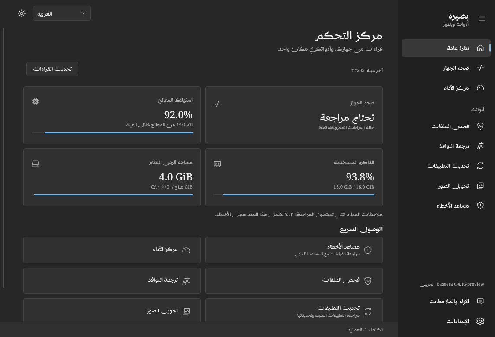
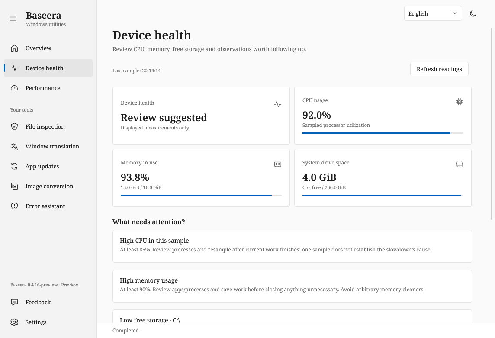
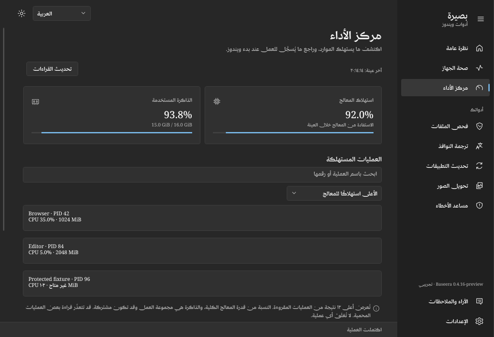

# Device control center — development 0.4.16

This extends the current Windows app. It is not included in the published
0.4.15 download until a later release is explicitly published.

The Overview becomes a control center with device status, sampled CPU utilization,
physical memory use, free system-drive space, a count of resource observations and
quick access to the existing tools. The sidebar adds **Device health** and
**Performance**; feedback and Settings remain at the bottom. Arabic RTL, English,
French, Spanish, the supplied fonts, both themes and existing motion preferences
are preserved. Download/update counts are not fabricated: app updates remain an
explicit existing workflow, not an assumed number on the dashboard.

## Measurements and boundaries

- CPU uses two `GetSystemTimes` reads separated by about 850 ms, with kernel idle
  time counted correctly. This is utilization, not temperature or a sustained-load
  diagnosis. More than 64 active processors are explicitly unsupported for this
  aggregate, since the API only covers the calling processor group in that case.
- RAM is total/available physical memory from `GlobalMemoryStatusEx`. It is not an
  estimate obtained by summing processes. Values are volatile snapshots.
- Storage is capacity and currently available bytes on at most 32 fixed local
  volumes. The system volume is identified from Windows' system directory. No
  file contents are scanned, and no SMART, temperature, disk I/O or hardware
  integrity claim is made. Remote/removable drives are excluded.
- The performance view samples at most 512 readable processes using PID plus
  start time to avoid mixing reused process IDs. CPU deltas are normalized to
  active processor count. Search/filter and CPU/memory sorting display the top
  twelve matching results. Working-set memory can be shared; it must not be summed.
  Protected/exited processes and caps produce coverage notices. No command lines,
  executable contents or process termination are used.
- Startup registrations come from HKCU Run, the 64/32-bit HKLM Run views and the
  user/all-users Startup folders. Only names/source are shown; command values and
  shortcut targets are not read or executed. Network-redirected Startup folders
  are excluded. The list is capped at 100 and reports partial coverage. It does
  not determine enabled state or measured boot impact and does not enumerate all
  services, scheduled tasks or packaged-app startup tasks. A button opens Windows'
  own Startup settings for user-controlled changes.

Basic readings refresh every ten seconds while Overview/Device health/Performance
is displayed and the main window is not minimized. Only the performance page
automatically reads process/startup names. Settings can disable automatic collection;
manual Refresh remains available. Navigating away cancels the request and discards
late updates. Old values keep their timestamp and are not relabeled as fresh on a
failed refresh. Data is temporary memory state, without telemetry or AI upload.

Resource observations use explicit thresholds: CPU at least 85%, memory at least
90%, or free space below 10% / below 5 GiB on the system drive. The count is not
the number of Windows errors. Missing sources produce **Partial readings** or
**Unavailable**, never a zero reading or a clean-device certificate. A single
sample does not establish the cause of slowness or justify killing a process.

## Combined Smart Repair evidence

**Review readings with Smart Repair** retains the existing assistant and AI setup
flow. If setup is missing, main Settings opens and the pending review survives
until the assistant is opened. The action inserts the snapshot into the editable
diagnostic preview; it never sends it automatically. Existing composer text is
preserved; an empty composer gets a review question which the user can edit.

The assistant adds an optional **Current device health and performance** source.
Users may select that source plus Application/System event channels and collect
them together. Other sources remain unchecked. Review/edit/redact the complete
preview, then give the existing one-request sharing approval. Device snapshots
can contain process names and reveal app usage; diagnostic text includes no command
lines or startup names. It includes at most eight processes from CPU/memory leaders.

The existing AI instruction channel asks the selected service to relate supplied
readings to event evidence, distinguish observation from hypotheses, compare
timestamps and explain missing coverage. An old event and a high current sample
do not establish causation. Model quality and account access remain external limits.
Private diagnostic exchanges stay excluded from follow-up context. Editing,
recollection, source changes and recipient changes invalidate consent. The three
fixed repair actions and their separate explicit approval/UAC boundaries remain
unchanged. No startup entry or running process is automatically changed.

## Verification

Core tests exercise CPU idle arithmetic and overflow/reset cases, per-process
normalization, invalid memory/volume readings, threshold findings, bounded inert
labels and opt-in diagnostics. The focused suite runs with
`--smoke <output> --device-only` and is also included in the full smoke run.
Use `build.ps1 -Smoke` or set `BASEERA_DATA_DIR` to a disposable test directory first.

The suite samples native CPU/RAM/fixed volumes and bounded process/startup sources
without saving their actual values or names, and uses injected fixtures for all
screenshots and detailed process/startup assertions. It tests
PID reuse, cancellation, basic-source privacy, 24 locale/theme/page combinations,
filtering/sorting, missing/partial/stale/error states, setup round trips, combined
device/event previews, one-request consent and private-context exclusion. No real
event logs, AI request, microphone, registry write or repair command is used.

API references checked on 2026-10-25:
[GetSystemTimes](https://learn.microsoft.com/en-us/windows/win32/api/processthreadsapi/nf-processthreadsapi-getsystemtimes),
[GlobalMemoryStatusEx](https://learn.microsoft.com/en-us/windows/win32/api/sysinfoapi/nf-sysinfoapi-globalmemorystatusex),
[Run keys](https://learn.microsoft.com/en-us/windows/win32/setupapi/run-and-runonce-registry-keys),
[Windows Startup settings](https://support.microsoft.com/en-us/windows/experience/startup-boot/configure-startup-applications-in-windows).

