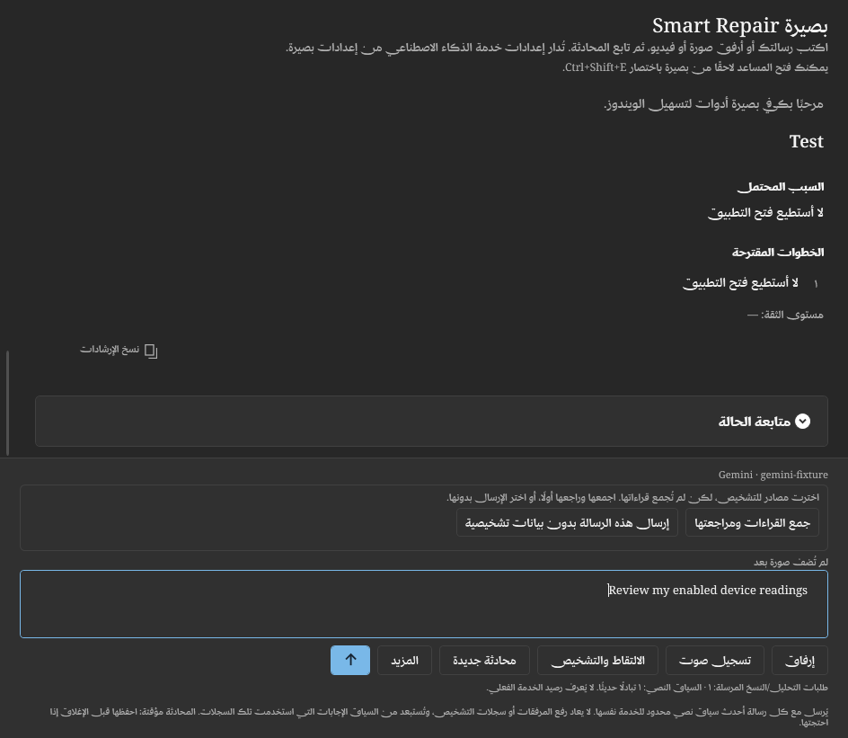
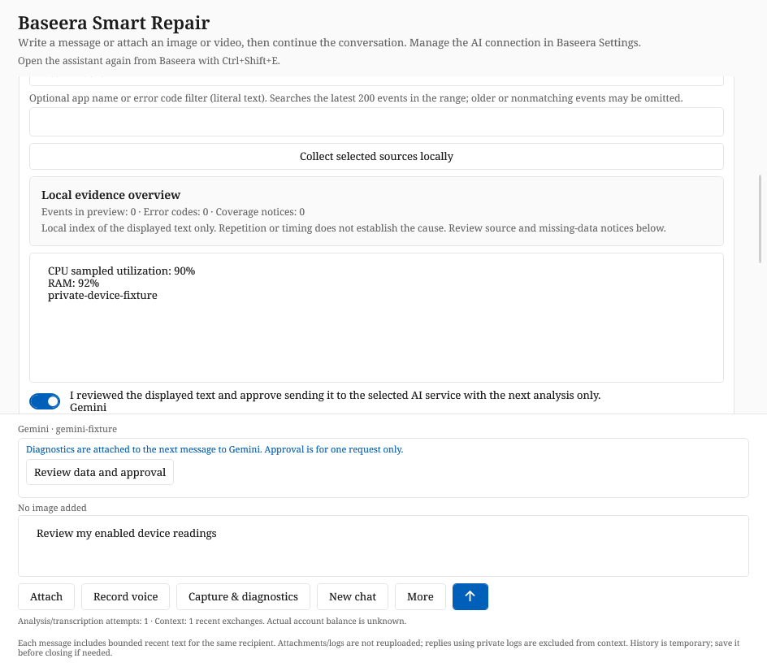

# Diagnostics selected versus attached — development 0.4.16

Selecting **Current device health and performance** chooses a local collection
source. It does not collect readings or authorize sending them. Previously the
assistant could still submit the user's review question with an empty
`approved_diagnostics` field. The model could truthfully reply that no diagnostic
evidence had been shared, while the source checkbox still looked enabled.
After a diagnostic request, its one-request approval also expires while the source
selection remains checked. Private diagnostic exchanges are excluded from future
conversation context, so old readings are not automatically available in follow-ups.

The composer now displays the actual per-message attachment state:

| State | Next action |
| --- | --- |
| No diagnostic data attached | Ordinary text/image/video chat can send normally. |
| Selected sources, no collected readings | Collect and review the selected sources locally. |
| Preview present, not attached | Review the text and explicitly approve sending it with the next analysis. |
| Attached to the next message | The displayed preview will be included once, for the named recipient. |
| Included in the current request | That immutable approved snapshot is part of the in-flight request. |
| Previous approval used | Review and approve again if the next message needs diagnostic evidence. |

If sources or a diagnostic preview are selected but not approved, **Send pauses
before any model request or usage-counter increment**. It preserves the draft and
offers collection/review or an explicit **Send this message without diagnostics**
action. That text-only choice is for this attempt; it does not grant diagnostic
consent or silently transfer private data through history. Empty text-only attempts
remain blocked. A diagnostic-only message can send once its displayed data is approved.

**Collect and review readings** performs only the selected local collection. It
opens the existing preview but does not check the consent box. **Review data and
approval** opens/focuses that box; the user must still approve it. No inferred
blanket approval, persistent background sharing or automatic retry is added.

Source changes, preview edits, recollection and recipient changes keep invalidating
approval. The same provider adapters, one-request consent and repair/UAC boundaries
remain unchanged. This affects development 0.4.16; it does not modify the published
0.4.15 executable.

`--smoke <output> --diagnostic-delivery-only` runs the focused fixtures; the full
suite also writes `diagnostic-delivery-result.txt`. Run with a disposable
`BASEERA_DATA_DIR`. Tests verify the actual request argument, not just checkbox
appearance: no startup collection, no silent missing-data submission, explicit
collection/review, approved and diagnostic-only payloads, in-flight/consumed states,
explicit text-only sends, empty input, edit/recipient invalidation and private-context
exclusion in all four interface languages. AI and diagnostic sources are fake;
screenshots contain no real account credentials or local diagnostic data.

