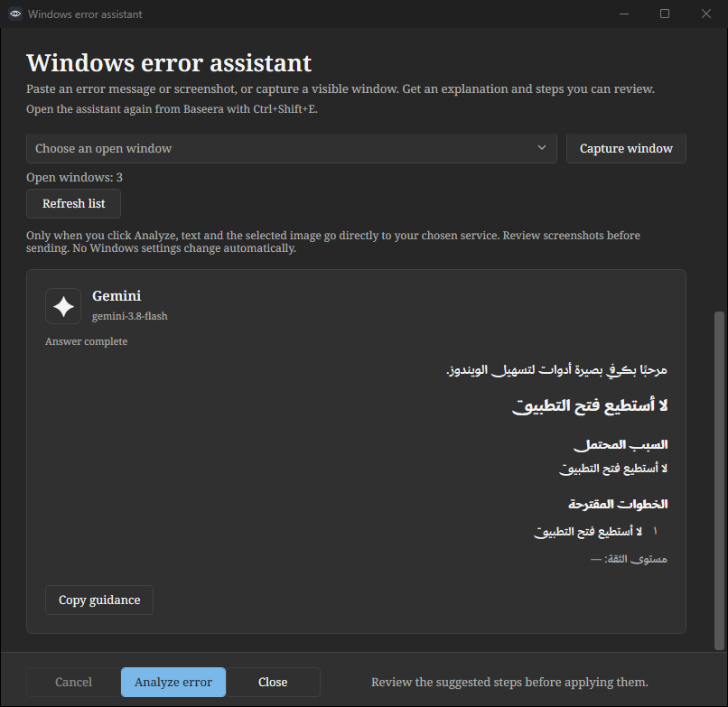
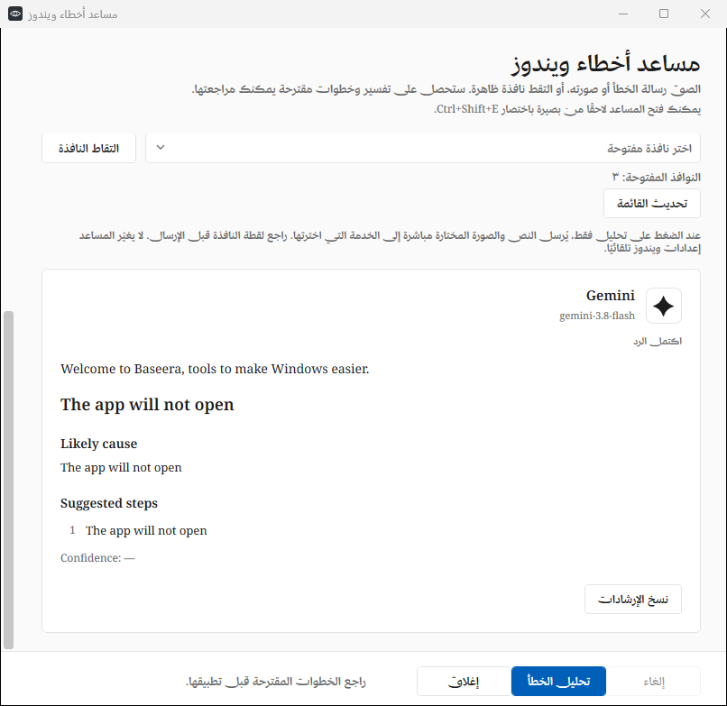
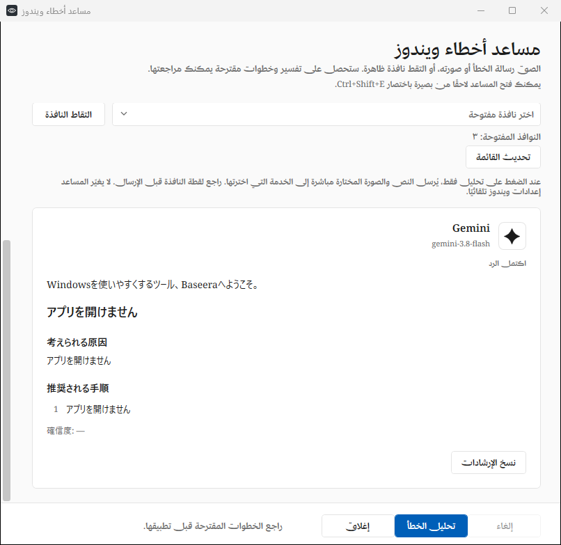

# Baseera error assistance: instructions and reply languages

Baseera 0.4.11 supplies its troubleshooting role automatically with every request.
The user can paste error text, attach a screenshot, or use both. They do not need
to write a prompt explaining how the assistant should behave. This is inference-time
instruction, not fine-tuning or a claim that a provider was specially trained on
Baseera or the user's device.

The versioned instructions and Gemini response schema live in
[`ErrorAssistantPrompt.cs`](../src/Baseera.App/Services/ErrorAssistantPrompt.cs).
Provider adapters send them separately from the input:

| Connection | Instruction channel |
| --- | --- |
| Gemini | `systemInstruction.parts` |
| OpenAI API, Grok Responses | `instructions` |
| ChatGPT account | `instructions`, retaining `store:false` and `stream:true` |
| Claude | Top-level `system` |
| Cohere and the other Chat Completions adapters | A separate first `system` message |

User text is JSON-encoded as `error_text` alongside `fallback_language` and
`image_attached`. An optional image stays in the normal user image content block.
Neither is interpolated into the higher-priority instructions. This separation
helps preserve the intended task; it is not a guarantee against every model error
or prompt-injection attempt.

## Welcome and response language

The first answer paragraph is the localized Baseera welcome:

- Arabic: **مرحبًا بك في بصيرة أدوات لتسهيل الويندوز.**
- English: **Welcome to Baseera, tools to make Windows easier.**
- Other languages: the same welcome translated by the selected model.

The exact Arabic/English/French/Spanish welcome is normalized locally by the
reported reply-language tag, including regional tags such as `ar-SA`. This does
not depend on the interface's currently selected language.

The instructions choose the reply language in this order:

1. The user's own explanation. Arabic explanation plus an English error log
   should produce Arabic guidance.
2. Meaningful pasted error text when there is no separate explanation.
3. Readable screenshot language when meaningful text is absent.
4. The interface language for code-only input, unreadable images or ambiguity.

Greeting, cause/steps/checks/confidence headings, and explanatory content use that
reply language. Error codes, product names, paths and code are preserved. Response
language is not limited to the four interface languages, but actual language
understanding and translation quality depend on the selected provider/model.
The app's navigation, buttons and status text still use the selected interface
language.

The response includes a required, bounded `locale` object with a BCP 47 language
tag, `ltr`/`rtl` direction, welcome and translated section headings. Only validated
structured advice is displayed. The answer body uses its own text direction and
language, allowing Arabic, Urdu, Persian and Hebrew in an English interface. The
provider/model identity and controls retain the app's normal layout. Progressive
display starts with the welcome, and Copy includes it and all localized labels.

## Guidance and verification limits

Instructions ask for evidence-aware likely causes and 1–8 ordered steps. Text alone
must be accepted when sufficient; an image is not compulsory. Missing information
should produce focused follow-up checks. The assistant must not claim it has fixed
the device, guarantee an immediate solution, invent commands/URLs, or recommend
deleting user data or bypassing security. Baseera still provides advice; it does
not automatically execute those suggestions.

Automated tests inspect fake HTTP payloads for all twenty adapters, verify text-only
and image request handling, reject malformed locale metadata, and render fifteen
sample reply locales independently of interface language. They also cover greeting
ordering, section labels, text direction and exact Arabic welcome normalization.
Fixtures verify the integration and presentation contract, not live model language
detection, translation quality, or troubleshooting accuracy. No real credentials
or paid inference are used by these checks.

Official request-format references:

- [OpenAI instructions and message roles](https://developers.openai.com/api/docs/guides/text)
- [ChatGPT plan request requirements](https://developers.openai.com/siwc/token-sharing-open-source/preview-limitations)
- [Gemini system instructions](https://ai.google.dev/api/generate-content)
- [Claude system parameter](https://platform.claude.com/docs/en/api/messages/create)
- [Cohere message roles](https://docs.cohere.com/v2/reference/chat)
