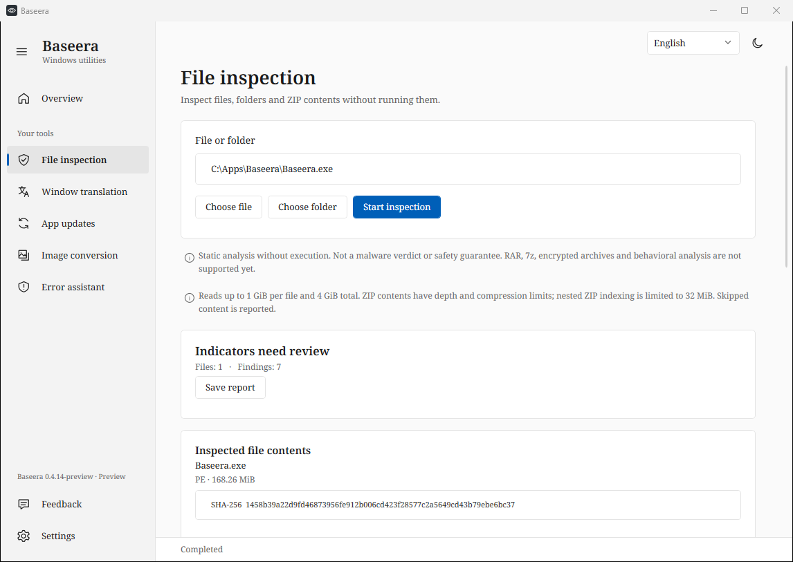

# File inspection

From 0.4.14, raw files are read in pooled 256 KiB blocks with overlap for indicator
matches across blocks. SHA-256 includes every byte read. UTF-8 and both UTF-16 byte
orders are examined; each rule is reported once per file. Matching timeouts are
reported as incomplete coverage. Files are never executed or uploaded.

Default limits: 1 GiB per file, 4 GiB total bytes read (including archive containers
and decompressed entries), 3,000 entries, four archive levels and a 200:1 compression
ratio. Seekable ZIP files are indexed from disk; non-seekable nested ZIPs can use
at most 32 MiB for indexing. Directory metadata is bounded to 8 MiB. ZIP64,
encrypted, damaged and unsupported archives remain explicitly incomplete.

This is a bounded static indicator scanner. It does not unpack executable packers,
establish certificate trust, trace behavior, inspect encrypted contents or guarantee
malware detection. A reference to an API or an unsigned file is a reason to review
context, not proof of malware. Mods are evaluated by content rather than extension.

The UI shows reading progress, file sizes and copyable hashes. JSON export retains
technical evidence and coverage limitations. Large files above the limits remain
explicitly uninspected; they are never silently marked safe.

Regression checks cover a 72 MiB file with boundary-spanning, middle and final
indicators, both UTF-16 byte orders, an independently computed full hash,
cancellation during reading, total-byte limits and nested archive memory limits.
Packaged UI checks also press Inspect on the running self-contained executable
and compare its byte count and hash with an independent SHA-256 pass.

