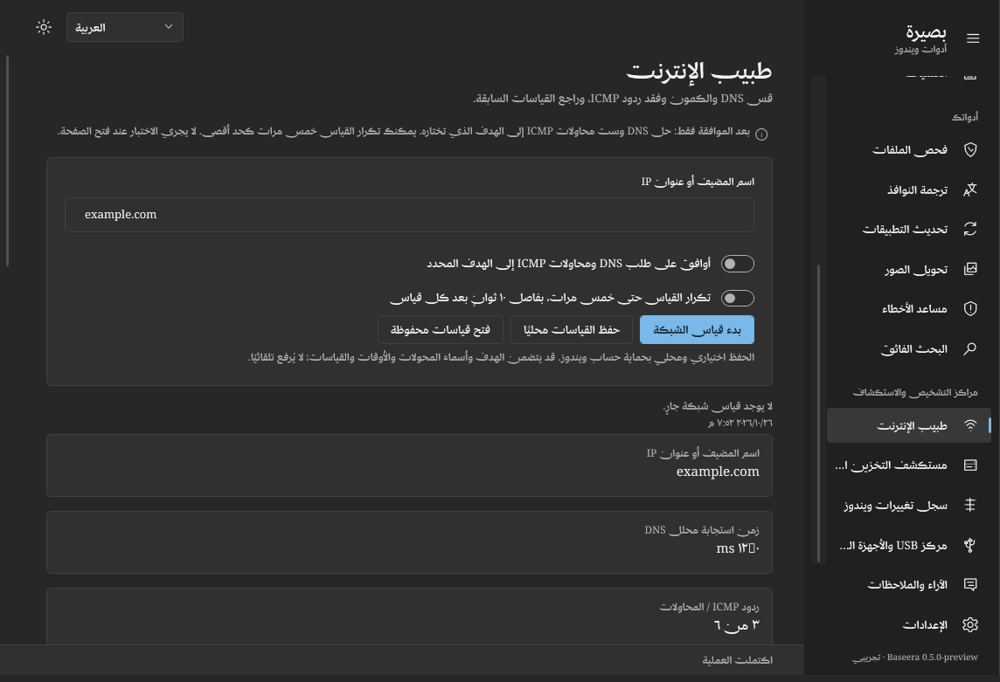

# بصيرة

**قيد التطوير — 0.5.0-preview.** أُضيفت ثمانية مراكز للاستكشاف والتشخيص على فرع التطوير، بالإضافة إلى العمل المبين أدناه. لم تُنشر في تنزيل التطبيق بعد؛ الإصدار المتاح للعامة ما زال **0.4.15-preview**.



الصورة من «طبيب الإنترنت» على فرع التطوير، والقياسات المعروضة أمثلة اختبار وليست بيانات جهاز حقيقي أو تشخيصًا مؤكدًا.

أضيف طبيب ويندوز الذكي، ومحلل بطء الجهاز، ومركز الأمان، وطبيب الإنترنت، ومستكشف التخزين، والبحث المحلي، وسجل النظام، ومركز USB. تبدأ القراءات بعد اختيار المستخدم، وتُعرض حدود الأدلة بوضوح؛ ولا تُرسل إلى الذكاء الاصطناعي إلا بعد معاينة وموافقة مستقلة لطلب واحد. [النطاق الفعلي والخصوصية والقيود](INVESTIGATION-CENTERS.md).

## الميزات الجديدة قيد التطوير

- مركز تحكم يعرض المعالج والذاكرة والمساحة الحرة، ووقت القراءة، والملاحظات والوصول السريع للأدوات.
- صفحة لصحة الجهاز مع الحالات غير المتاحة والجزئية، وتحديث محلي اختياري للقراءات.
- مركز أداء لمراجعة العمليات واستهلاكها وبرامج بدء التشغيل، مع البحث والترتيب، دون إيقافها أو تعديلها تلقائيًا.
- جمع قراءات الجهاز وسجلات أخطاء ويندوز ومعلومات النظام التي تختارها، ومعاينتها قبل الموافقة على مشاركتها لطلب واحد.
- Smart Repair بأربع مراحل: اكتشاف، وتحليل أدلة، ومراجعة إصلاح محدد والموافقة عليه، ثم إعادة الفحص.
- قراءة اختيارية لحالة ست خدمات محددة؛ توقف الخدمة وحده لا يثبت وجود عطل.
- ملفات قضايا محلية محمية بحساب ويندوز، تتضمن وقت ظهور المشكلة والأدلة والتحليل والإجراءات والنتائج والمقارنات، مع اختيار منفصل لحفظ التشخيص الخام.
- مقارنة قراءات قبل الإجراء وبعده، مع إظهار الشكوك والبيانات الناقصة؛ تغيّر القراءة أو رمز خروج ناجح لا يثبت زوال المشكلة.
- مركز للعمليات والتقدم والإلغاء المدعوم، دون إنهاء أدوات إصلاح ويندوز بالقوة.
- تحسين لوحة المفاتيح والأسماء المقروءة وحالة العمليات والتباين العالي ودعم اللغات الأربع وRTL؛ التدقيق الشامل بقارئ شاشة ما زال مطلوبًا.
- فصل تدريجي لمنطق القضايا عن الواجهة باستخدام MVVM وحقن الخدمات؛ لم يُعد بناء التطبيق كله.
- قناتا Stable وPreview، دون خفض تلقائي للإصدار، مع الحفاظ على التحديث داخل التطبيق والاستعادة عند فشل التثبيت.
- دعم توقيع الملفات بشهادة تختارها؛ لا توجد شهادة ناشر بعد، لذلك الملفات الحالية غير موقعة.
- فحص تبعيات وتحليل CodeQL واختبارات لمدخلات تالفة وغير موثوقة؛ اجتيازها لا يضمن الأمان.
- اختبارات SFC وDISM معزولة داخل جهاز Windows Server افتراضي على GitHub؛ التحقق الشامل على Windows 10 و11 ما زال مطلوبًا.

[تفاصيل القضايا والاختبارات](SMART-REPAIR-WORKFLOW.md) · [صحة الجهاز والأداء](DEVICE-CENTER.md) · [التحديث والتوقيع والاستعادة](RELEASE-CHANNELS.md) · [التطوير الجاري](https://github.com/yabs117/baseera/pull/2)

## المتاح في الإصدار المنشور

في الإصدار 0.4.15 أصبحت [محادثات المساعد مستمرة](CONVERSATIONS.md)، مع كتابة ثابتة أسفل النافذة، والصور والفيديو، وتسجيل صوتي محلي يُحوَّل إلى نص بعد الموافقة. يطلب التطبيق السماح بالمتابعة بعد كل عشرة طلبات تحليل أو نسخ صوتي؛ هذا عدّاد محلي وليس قراءة لرصيد حسابك. السجل والسياق محدودان للحفاظ على الذاكرة والاستهلاك، ويمكنك مواصلة الحديث دون حد ثابت لعدد الرسائل الإجمالي.

تُدار الخدمة والمفتاح أو تسجيل الدخول والنموذج من «الإعدادات ← خدمة الذكاء الاصطناعي» فقط. بعد الحفظ يمكنك الضغط على «جرّب الاتصال» ثم «فتح مساعد الأخطاء» لتبدأ المحادثة مباشرة. الاختبار اختياري وقد يستهلك رصيدًا؛ يستخدم صورة تجريبية صغيرة دون محادثاتك أو ملفاتك أو بيانات التشخيص. العودة إلى الإعدادات تحفظ المحادثة المؤقتة والمسودة والمرفقات في الذاكرة. [تفاصيل الإعداد والاختبار](AI-SETTINGS.md).

في الإصدار 0.4.15، تتوفر فترات تشخيص قابلة للاختيار وتصفية للأحداث باسم التطبيق أو رمز الخطأ، وملخص محلي للأدلة وسجل للإصلاحات وملاحظاتك عن النتيجة. يمكنك حفظ تقرير الحالة محليًا؛ تُستبعد التشخيصات افتراضيًا. إذا تغيّر وصف المشكلة أو صورتها تُعطّل إصلاحات النتيجة السابقة حتى إعادة التحليل.

**الإصدار التجريبي 0.4.15:** أصبح المساعد الحالي «Baseera Smart Repair» مع تشخيصات اختيارية للقراءة فقط من سجلّي Application وSystem وملخص نظام مختصر. تجمع البيانات محليًا وتراجعها قبل الموافقة على مشاركتها مع التحليل القادم فقط. الإصلاحات المتاحة محددة: مسح ذاكرة DNS، وSFC، وDISM؛ كل أمر يحتاج مراجعة تأثيره وموافقة مستقلة، وطلب صلاحيات ويندوز عند الحاجة. لا تشغيل لأوامر حرة أو إعادة تشغيل تلقائية. [التفاصيل والحدود والاختبارات](SMART-REPAIR.md). [ملاحظات الإصدار والتنزيل](RELEASE-0.4.15.md).

تطبيق ويندوز تجريبي مفتوح المصدر يجمع فحص الملفات، وترجمة النوافذ، وتحديث
التطبيقات المختارة، وتحويل الصور، ومساعد أخطاء ويندوز. الواجهة تدعم العربية RTL والإنجليزية والفرنسية والإسبانية.

## التشغيل

تظهر نافذة ترحيب عند أول تشغيل، تلخّص الأدوات وتشرح الخصوصية وتتيح تغيير اللغة والمظهر.
بعد المتابعة تختار الأدوات التي تريد تفعيلها. تظهر مرة واحدة افتراضيًا، ويمكن تفعيل
عرضها عند كل تشغيل، أو فتحها من «الإعدادات ← المظهر واللغة ← التعرّف على بصيرة».

يتطلب Windows 10/11 بمعمارية x64. تتضمن النسخة المنشورة بيئة .NET ولا تحتاج تثبيتها منفصلة. افتح `Baseera.exe` من مجلد النسخة
المنشورة. عند أول تشغيل تكون الأدوات الأربع الأصلية معطّلة، ومساعد الأخطاء مفعّل افتراضيًا ويمكن إيقافه من الإعدادات.

للبناء من المصدر، ثبّت .NET SDK 10 ثم نفّذ من PowerShell:

```powershell
./build.ps1 -Test -Publish
```

الملف التنفيذي لنسخة التطوير في `artifacts/Baseera-v0.5.0-Windows-x64/Baseera.exe`، وتوجد نسخة باسم مختصر في `artifacts/Baseera.exe` وحزمة `artifacts/Baseera.zip`.

حمّل [تطبيق ويندوز](https://github.com/yabs117/baseera/releases/download/v0.4.15-preview/Baseera.exe) مباشرة.
إضافة المتصفح حزمة اختيارية منفصلة: اقرأ `START-HERE.html` وثبّتها من المتصفح، ولا تفتح ملفات الشيفرة بالنقر المزدوج.

## الاستخدام

**مساعد أخطاء ويندوز:** يظهر ضمن «أدواتك» في النظرة العامة والقائمة الجانبية، وله صفحة تفتح المساعد عند اختيارك. في نسخة التطوير الحالية، يبقى التشغيل العادي على النظرة العامة؛ لا يُفتح المساعد تلقائيًا. عند طلب فتحه دون اتصال محفوظ، تُفتح إعدادات بصيرة لإدخال المفتاح أو تسجيل الدخول واختيار نموذج يدعم النص والصورة؛ لا توجد استمارة إعدادات داخل المحادثة.
الصق صورة مباشرة أو انسخ ملف صورة محفوظًا، أو اختر صورة من الملفات أو التقط نافذة مفتوحة؛ تظهر المعاينة فورًا. يمكنك أيضًا لصق رسالة الخطأ، ثم الضغط على «تحليل الخطأ». يُرسل النص والصورة المختارة مباشرة إلى الخدمة المحددة عند ضغط الزر فقط. راجع لقطة النافذة قبل الإرسال لأنها قد تحتوي بيانات خاصة.
النتيجة تفسير وخطوات مقترحة للمراجعة، وليست إصلاحًا مضمونًا أو تغييرًا تلقائيًا
لإعدادات ويندوز. افتح المساعد مجددًا باختصار Ctrl+Shift+E من داخل بصيرة.

**تحديث بصيرة نفسه:** ابتداءً من 0.4.0 يبحث التطبيق عن إصداراته الرسمية عند الفتح
ثم كل ساعتين أثناء تشغيله. تظهر نافذة بملاحظات الإصدار وحجمه؛ اختر «تحديث وإعادة
التشغيل» لتنزيله والتحقق منه واستبدال الملف الحالي في مكانه، مع الاحتفاظ بالإعدادات
والمفتاح المحفوظ. تُحفظ نسخة احتياطية حتى تعمل نافذة الإصدار الجديد، ويُسترجع السابق
عند فشل الاستبدال أو التشغيل. احفظ تعديلات الإعدادات وأغلق النسخ الأخرى أولًا.
يمكن البحث يدويًا أو تعطيل الفحص التلقائي من «الإعدادات ← تحديثات بصيرة».
ضع الملف في مجلد دائم تملك صلاحية الكتابة فيه. الإصدارات السابقة لـ0.4.0 تحتاج
تنزيل هذه النسخة مرة واحدة للحصول على الميزة. إضافة المتصفح تُحدَّث بشكل منفصل.

**الفحص:** اختر ملفًا أو مجلدًا ثم ابدأ. يفحص محتوى ZIP المتداخل والسكربتات
وبنية ملفات PE، دون تشغيلها. النتيجة أدلة تحتاج مراجعة وليست شهادة بأن الملف آمن
أو ضار. الحزم غير المدعومة والأجزاء التي تتجاوز الحدود تُعرض كفحص غير مكتمل.

**تسجيل الدخول دون مفتاح:** اختر OpenAI ثم «المتابعة باستخدام ChatGPT» أسفل مزود الخدمة. أكمل الدخول والموافقة في المتصفح الرسمي، ثم اختر الحساب والنموذج واحفظ الإعدادات. تستخدم الطلبات المؤهلة خطة ChatGPT أو رصيدها وفق حدود حسابك. تتوفر إضافة حساب آخر وتجديد الجلسة وتسجيل الخروج وإدارة الاستخدام. الخدمات الأخرى تستخدم مفاتيحها حاليًا. [تفاصيل الربط وحدوده](CHATGPT-SIGN-IN.md).

**الترجمة:** اختر من 20 خدمة مباشرة، ومنها Gemini وOpenAI (نماذج ChatGPT) وClaude وGrok وMistral وCohere وQwen وKimi. أضف مفتاح الخدمة نفسها، ثم حمّل قائمة نماذج الصور واختر النموذج دون كتابة اسمه. أُزيل OpenRouter وأُصلح انهيار تبديل الخدمة. لكل خدمة مفتاح مستقل. قد تتطلب النماذج رصيدًا أو تفعيلًا؛ وعند غياب السعر يظهر «حسب الحساب». راجع [قائمة الخدمات والتفاصيل](AI-SERVICES.md).
اختر نافذة مفتوحة ولغة الترجمة واضغط الالتقاط والترجمة. تُرسل لقطة النافذة إلى الخدمة المختارة؛
لا تختَر نافذة تحتوي معلومات لا تريد إرسالها. أغلق الطبقة بزر Esc. الترجمة
الحية تحتاج مفتاحًا وحصة API؛ لم تُختبر باستخدام مفتاح شخصي ضمن اختبارات المشروع.

قائمة النوافذ تتحدث عند فتحها، وتعرض العدد والنوافذ المصغّرة والتطبيق نفسه، وتستبعد النوافذ المخفية ونوافذ الخلفية المحجوبة بواسطة ويندوز والنوافذ المساعدة. تُستعاد النافذة المصغّرة عند اختيار التقاطها. زر «الإعدادات» من صفحة الترجمة ينقلك مباشرة إلى قسم خدمة الذكاء الاصطناعي، ويضع المؤشر في حقل المفتاح أو قائمة النموذج.

**الآراء والملاحظات:** اكتب اقتراحك أو تفاصيل الخطأ من القسم الموجود فوق «الإعدادات». تفتح بصيرة بلاغ GitHub جاهزًا للمراجعة؛ اضغط إرسال هناك بعد مراجعة النص. لا تُرفق صورًا أو مفاتيح API تلقائيًا.

**ترجمة المتصفح:** افتح `chrome://extensions` أو `edge://extensions`، فعّل وضع
المطوّر، واختر تحميل إضافة غير مضغوطة ثم مجلد `extension`. افتح صفحة ويب واضغط
أيقونة الإضافة وأدخل المفتاح والنموذج. تُرسل النصوص عند الضغط فقط، ويمكن استعادة
الأصل. المفتاح منفصل عن مفتاح التطبيق ويُحفظ لجلسة المتصفح فقط.

**التحديثات:** حدّث القائمة وحدّد التطبيقات المدعومة. التحديد يجيز تحديثها عند
بدء التطبيق ثم كل ست ساعات ما دام مفتوحًا. المصدر اليدوي لكل تطبيق يتجاوز WinGet
ويفحص صفحة GitHub Releases؛ يعرض الإصدار للمراجعة ولا يشغّل مثبت المصدر اليدوي تلقائيًا.
مصادر المواقع الأخرى غير مدعومة بعد. قد يتطلب WinGet موافقة أولية أو صلاحيات.

تظهر أسماء التطبيقات وأيقوناتها من بيانات التثبيت وملفات البرامج وموارد تطبيقات
ويندوز المعبّأة، مع أيقونة افتراضية عند تعذّر المطابقة بثقة. ابحث بالاسم أو
المعرّف أو الناشر، واعرض المحدّد فقط. خيارات المصدر قابلة للفتح لكل تطبيق؛
تبقى القائمة والاختيارات ومسودات الروابط محفوظة عند التنقل أو تغيير المظهر.

**التحويل:** اختر الصور، رتّبها، ثم اختر الصيغة. PDF يضمها حسب ترتيب القائمة.
تُحفظ الأصول، وتضاف أرقام لأسماء الصور الناتجة عند وجود ملف سابق.
فعّل تكامل مستكشف الملفات واحفظ الإعدادات. حدّد الصور في المستكشف ثم اضغط
Ctrl + كليك يمين أثناء تشغيل بصيرة، أو استخدم الأمر من «إظهار المزيد من الخيارات».

## الخصوصية وحدود النسخة

الفحص والتحويل محليان. المفتاح محمي بحساب ويندوز. بيانات الإعدادات في
`%LOCALAPPDATA%/Baseera`. الميزات غير المفعّلة لا تبدأ أعمالها.

هذه النسخة لا تحتوي مكافحة فيروسات شاملة أو تحليلًا سلوكيًا داخل جهاز افتراضي،
ولا تدّعي دقة 100%. راجع [حالة الميزات](ROADMAP.md) قبل الاعتماد عليها.

**عرض الإجابات:** يظهر شعار الخدمة واسم النموذج المستخدم فوق الرد. تُعرض الإجابة تدريجيًا بسرعة متوازنة، مع زر «إظهار الكل» لقراءتها فورًا. العربية من اليمين إلى اليسار، ويُحترم إعداد إيقاف الحركة في ويندوز. [التفاصيل والصور](ANSWER-PRESENTATION.md).

**تعليمات تلقائية للمساعد:** تُرسل تعليمات بصيرة مع كل تحليل لفهم الخطأ من النص أو الصورة، دون تدريب جديد. يبدأ الرد بـ«مرحبًا بك في بصيرة أدوات لتسهيل الويندوز.» بالعربية، وبترجمتها عند الرد بلغات أخرى. لغة شرح المستخدم تحدد لغة الرد وعناوينه واتجاهه، مستقلة عن لغة الواجهة. يعتمد فهم اللغات الأخرى على النموذج المختار. [التفاصيل](ERROR-ASSISTANT-PROMPT.md).

**إصلاح الاتصال والخروج (0.4.13):** تظهر لوحة تغيير الخدمة كاملة عند فتحها مجددًا، مع الحفاظ على النص والصورة. يسجل زر الخروج حساب ChatGPT خارج جميع أدوات بصيرة فورًا، ويبقى البرنامج مفتوحًا. لا تُحذف مفاتيح API أو نماذجها أو مسوداتها، ولا يتحول البرنامج إليها تلقائيًا.

**إزالة الحساب بعد الخروج (0.4.13):** يُحذف سجل الحساب الذي خرجت منه من بصيرة، بما فيه الاسم والبريد وبيانات الدخول. تظهر رسالة لإغلاق نافذة مساعد الأخطاء فقط؛ وعند فتحها مجددًا لا يظهر الحساب. تُنظّف أيضًا بقايا الحسابات التي خرجت منها في الإصدارات السابقة. تبقى مفاتيح API محفوظة.

**تحديث 0.4.14:** أصبح التنزيل باسم **Baseera.exe**. فحص الملفات يقرأ المحتوى على دفعات حتى 1 GiB للملف و4 GiB إجمالاً، ويعرض تقدم الفحص والبصمة؛ أُزيل عائق 64 MiB. حُسّنت تفاعلات القوائم والأزرار مع الحفاظ على التصميم والخطوط واتجاه العربية. يتضمن الإصدار ملف توافق للإصدارات القديمة كي يستمر التحديث داخل التطبيق.
