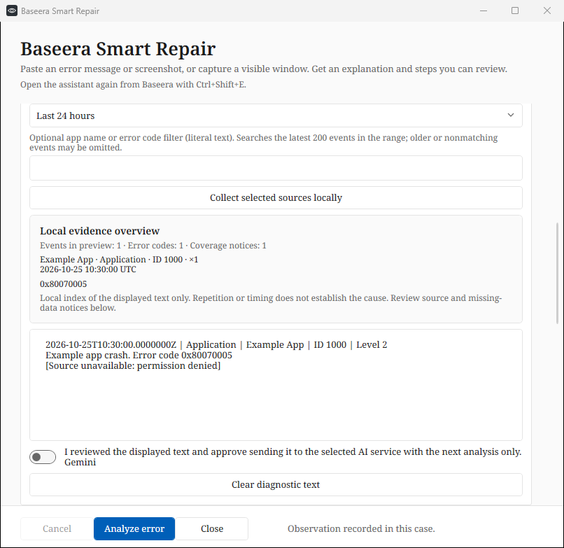
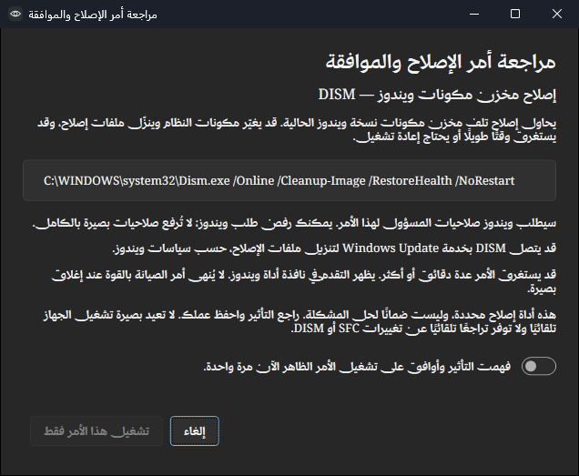
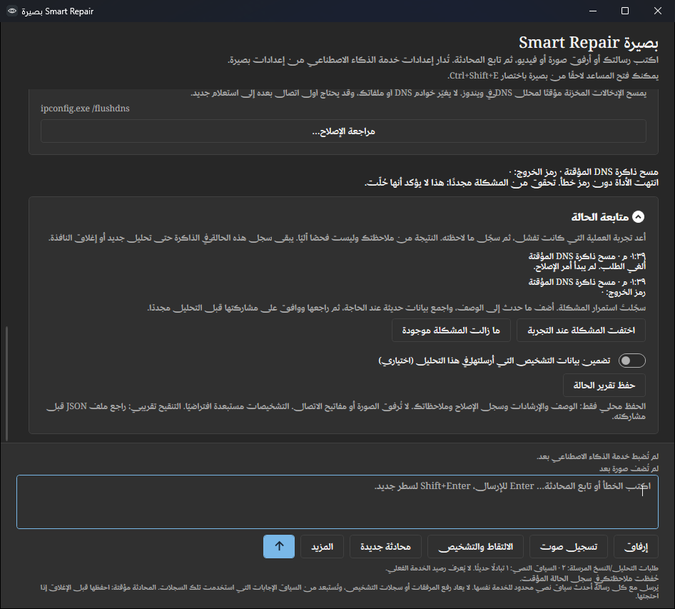

# Baseera Smart Repair — preview 0.4.15

Smart Repair extends the existing Windows error assistant. It keeps text-only and
image analysis, the current AI provider/account integrations, progressive responses,
the four interface languages, Arabic RTL, and the existing sidebar entry. These features are
included in [0.4.15-preview](RELEASE-0.4.15.md).
The [conversation presentation](ADVICE-PRESENTATION.md) adds submitted-message
context, selectable formatted replies, code copying and a quieter response layout.

## Workflow

1. Open the existing error assistant, describe the problem and optionally attach an image.
2. Expand **Optional read-only diagnostics** if local evidence would help. Select
   system summary, Application errors, System errors, or a combination. Nothing
   is selected or collected by default. Choose the last **1, 6, 24 or 72 hours**;
   optionally filter by a literal app/provider name or error code. Click
   **Collect selected sources locally**.
3. Read/edit the preview. It includes collection scope and unavailable/partial
   source notices. To share it, check the explicit consent for the next analysis.
   Without that consent, Analyze sends only the ordinary text/image input.
4. Analyze using the already configured AI service. The response explains likely
   causes, supporting evidence, missing information, safe steps and qualified
   confidence. Sparse logs do not prove a healthy device or establish causation.
5. When a catalog repair is recommended, finish reading the response and click
   **Review repair**. The separate dialog displays the exact system executable,
   arguments, effects, elevation/network implications and servicing limitations.
   Its acknowledgement is unchecked and Run is disabled by default. Approve the
   one displayed command, or cancel. Each execution needs fresh approval.
6. Review the local activity list: declined attempts, completed commands and exit
   codes remain distinct. Retry the failing operation and record **Problem no longer
   occurs** or **Problem still occurs**. This records your observation, not an
   independent verification. For an unresolved problem, update the description,
   collect fresh evidence if useful, and approve its next transmission again.
7. Optionally **Save case report** as a readable JSON file for yourself or a
   maintainer. Diagnostics are excluded by default; including the analyzed snapshot
   needs a separate checkbox. The screenshot and stored credentials are excluded.
   Saving stays local; review redacted text before sharing the file yourself.

## Evidence and case presentation

The local evidence overview indexes the **displayed editable preview**. It groups
recognized event headers by channel, provider and ID, counts repeated entries,
shows their latest UTC time and deduplicates eight-digit hexadecimal error codes.
Source-unavailable, deadline, data/sample-limit and truncation notices are counted
separately. This is a text index, not an authenticity check, calibrated diagnosis,
complete machine inventory or proof that a nearby event caused the reported issue.
At most twelve groups/sixteen codes are indexed and six groups are shown.

Repair cards expose their fixed command before opening the independent approval
dialog. If the user edits the description/image while a result is visible or being
generated, its repairs and outcome controls are disabled until the input matches
again or is analyzed anew. The report clearly remains a snapshot of the previous
analysis. A new analysis clears the previous case and its export-inclusion choice;
closing the window discards the in-memory case. Follow-up remains collapsed until
opened or an actual command attempt is recorded, and is hidden while text reveals.
Histories retain at most twenty
command attempts and twenty user observations. The latest five attempts are shown.

## Read-only collection and privacy

- The local event reader uses fixed **Application** and **System** channels only,
  reverse chronological critical/error entries from the chosen 1–72-hour range
  (24 hours by default), at most
  15 entries per channel and 1,600 characters per formatted message. No Security
  log, password store, installed-app inventory or personal file is requested.
- The system summary contains Windows version/build, architecture, logical CPU
  count, system-drive free MiB and approximate uptime. No username, hostname,
  device serial number, product key or machine GUID is included in that summary.
- Optional matching compares literal text against each event header and the first
  1,600 formatted message characters, ignoring case. It scans at most 200 recent
  critical/error events per channel within the chosen time range and deadline,
  returning at most fifteen matches. Filtering never changes the fixed channels or
  interpolates user text into the Windows XPath query. Older or nonmatching events
  can be omitted; zero matches do not rule out a problem. Without a filter only the
  most recent fifteen entries are read. A filled sample includes an omission notice.
- Collection checks an eight-second deadline between reads and supports reader
  cancellation. This is not a hard timeout around every native Windows API call.
  Denied/unavailable sources and partial/empty results are reported; collection
  never elevates to gain access. Preview and API diagnostic input are bounded to
  24,000 UTF-16 characters.
- Best-effort redaction covers common profile paths, local identities, emails,
  IP addresses, labelled secrets, bearer/API tokens and credential-bearing URLs.
  It is not a complete PII or secret detector. Logs may contain other sensitive
  details: the user must inspect the editable preview before sending.
- Collecting is local and does not call an AI service. Editing, recollecting,
  changing AI connections or clearing invalidates sharing approval. Approval is
  consumed for one analysis, bound to the selected provider/account. Only the
  displayed approved text is sent, as lower-trust JSON data; it never enters the
  higher-priority instruction channel. The selected provider's policies apply.
- Diagnostics are not saved in settings, attached to feedback, or automatically
  included in subsequent analyses. Clear discards the current editable preview;
  a snapshot actually sent for the current case remains in memory for optional
  report export until the next analysis or window close. Reports are written only
  when requested, diagnostics are excluded by default, and export redacts the
  snapshot again. Changing a source, range or filter clears the old preview/consent.

## Repair boundary

| Catalog ID | Fixed native invocation | Effect |
| --- | --- | --- |
| `flush-dns` | `ipconfig.exe /flushdns` | Clears cached DNS resolver entries; does not change DNS servers. |
| `sfc-repair` | `sfc.exe /scannow` | Administrator approval; attempts to repair protected system files. |
| `dism-repair` | `Dism.exe /Online /Cleanup-Image /RestoreHealth /NoRestart` | Administrator approval; repairs component-store corruption, may use Windows Update/network. |

Model output may recommend only these IDs, or none. It cannot supply an executable,
arguments, script, registry path or shell fragment to the runner. Recommendations
are validated before rendering. The runner reloads immutable catalog entries and
resolves the executable under the OS system directory instead of searching PATH.
There is no `cmd.exe`/PowerShell wrapper, remote script, scheduled task or automatic
registry editor. This first version deliberately offers only these three repairs.

Approval is tied to the canonical command, expires after five minutes and can be
consumed once. Repairs run one at a time across ordinary assistant windows. Windows
UAC is requested only for the selected native tool when required; Baseera itself
is not elevated by this flow. Rejecting either confirmation or UAC starts no repair.

Native progress is visible in the Windows tool window. Baseera reports exit status,
including restart-required code 3010; exit code zero is not proof that the original
problem is fixed. DISM includes `/NoRestart`; no reboot is scheduled by Baseera.
SFC/DISM can modify Windows and are not automatically reversible by this application.
After a tool starts, Cancel analysis does not kill servicing. Closing the assistant
while a repair is running requires confirmation and leaves the native tool running;
the result might not remain available in the closed assistant. Windows tools may
write their own standard servicing logs. Output is not silently uploaded to AI.

## Verification

Local verification on 2026-10-25: build and self-contained Windows x64 publish
completed with zero warnings/errors; **85 core checks**, **5 extension protocol
tests**, the existing **58 UI renders** and regression suites, and the additional
Smart Repair consent/source-selection/fake-execution/four-language checks passed
on the final packaged executable. This does not constitute live repair validation.

Run `./build.ps1 -Test` for core tests and `./build.ps1 -Smoke` for the UI suite;
`./build.ps1 -Publish -Smoke` additionally exercises the standalone package.
Smart Repair results are written to `smart-repair-result.txt` in the smoke output.

Unit checks cover source/time/size bounds, redaction, Unicode, fixed command IDs,
duplicate/injected recommendations, approval expiry/reuse and restart suppression.
UI/service checks use fixture diagnostics, fake HTTP and fake process launchers for
sharing consent, edited previews, cancellation, unavailable sources, approval
defaults, concurrent repair exclusion, UAC rejection and exit/restart states in all
four interface languages. Additional cases cover event grouping/code deduplication,
literal filtering and selected periods, stale-input repair/outcome rejection,
report redaction and default diagnostic exclusion, history bounds and case reset.
Existing provider, sign-out, translation, conversion and
updater checks continue to run. Automated checks do **not** collect real event logs,
show UAC, execute native repairs, validate a real AI's diagnostic accuracy or prove
successful Windows repair. Those require separately approved Windows/VM testing.

## Fixture previews

Implementation references: [EventLogReader](https://learn.microsoft.com/en-us/dotnet/api/system.diagnostics.eventing.reader.eventlogreader),
[SFC](https://learn.microsoft.com/en-us/windows-server/administration/windows-commands/sfc),
[repairing a Windows image](https://learn.microsoft.com/en-us/windows-hardware/manufacture/desktop/repair-a-windows-image),
[DISM global options](https://learn.microsoft.com/en-us/windows-hardware/manufacture/desktop/dism-global-options-for-command-line-syntax),
and [ipconfig](https://learn.microsoft.com/en-us/windows-server/administration/windows-commands/ipconfig).
