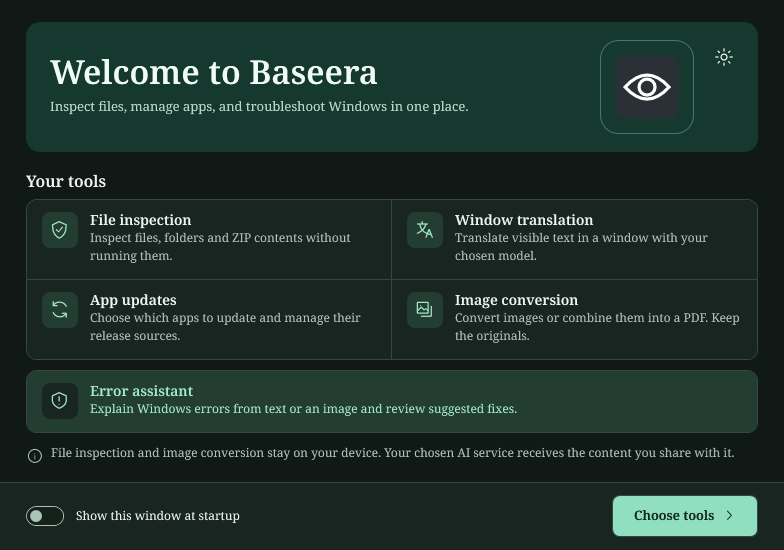
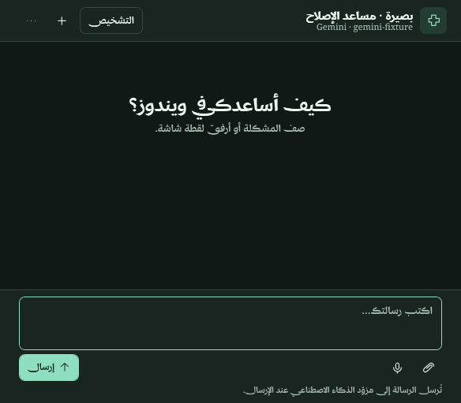
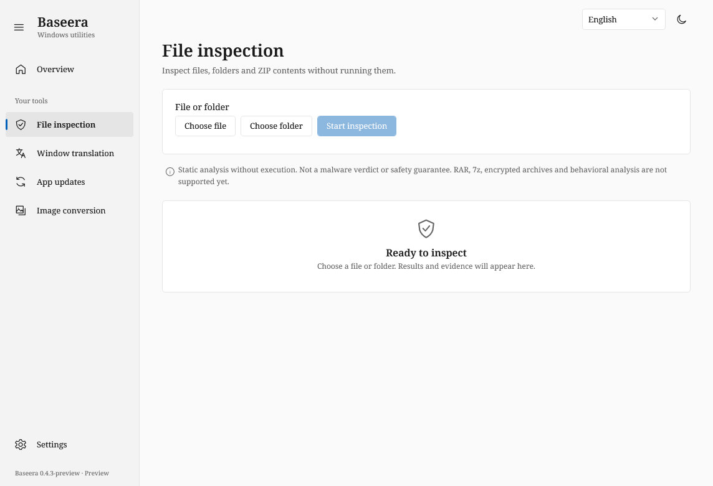
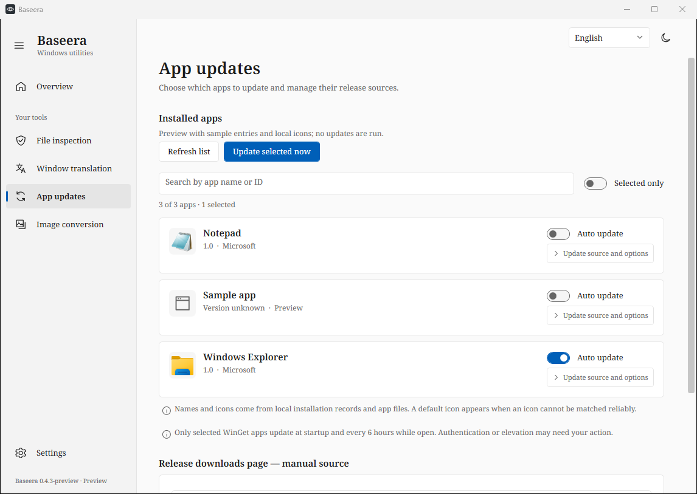
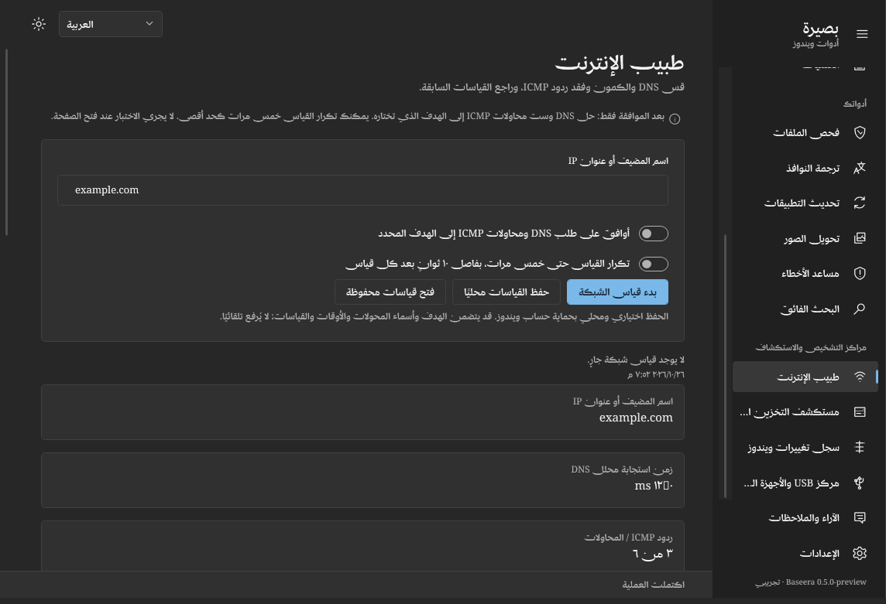

# Baseera user guide

## Download and run

1. Open [GitHub Releases](https://github.com/yabs117/baseera/releases) and expand **Assets** on the version you want.
2. Download `Baseera.exe` into a permanent, writable folder, or extract `Baseera.zip` first. The app includes its runtime for Windows 10 and 11 x64.
3. Open `Baseera.exe`. The welcome screen introduces the tools and lets you decide which to enable. You can reopen it under **Settings → Appearance and language → Getting started**.

To verify the download, compare its SHA-256 against `SHA256SUMS.txt` from the same release. See the release notes for that build’s signing status. GitHub’s **Source code** downloads contain the source. For the runnable version, choose the EXE or the desktop ZIP under **Assets**.

## Welcome screen

The 6.5.0 development build introduces a redesigned welcome screen.

## Choose a tool

| Task | Where to start |
| --- | --- |
| Review a file or ZIP | **File inspection** checks files, folders, and nested ZIPs locally. It reports file hashes, executable structure, and indicators to review. Skipped, encrypted, and unsupported content reduces coverage. [Inspection scope and limits](FILE-INSPECTION.md) |
| Translate an app | **Window translation** captures the selected window on request and shows a translated overlay. Use **Esc** to close it. Keep the window visible and unobstructed for capture. |
| Diagnose a Windows error | **Error assistant** opens Smart Repair. Enter an error or add an image, review what will be shared, and send it for analysis. **Ctrl+Shift+E** opens the assistant while Baseera is running. [Smart Repair](SMART-REPAIR.md) |
| Update apps | **App updates** discovers installed apps and lets you choose which ones can update through WinGet. A manually configured GitHub release source is for review. Local app icons appear when the source is unambiguous. |
| Convert images | **Image conversion** supports PNG, JPEG, BMP, TIFF, and ordered multi-image PDF. Source files are preserved. Use separate output filenames. |
| Review device health | **Device health** and **Performance** show recent resource readings and startup entries. The investigation tools cover security, network, storage, system events, USB, and local file search. [Device health](DEVICE-CENTER.md) · [Investigation centers](INVESTIGATION-CENTERS.md) |
| Find a tool | Press **Ctrl+K**, search by name or task, and press **Enter** to open the selection. |

File inspection is bounded static analysis. Its findings do not establish that a file is safe. Translation quality and overlay placement depend on the selected model and capture. Protected or full-screen content may be unavailable. TIFF or animated input uses the first frame. [Detailed capability status](ROADMAP.md)

## Connect an AI service

Open **Settings → AI service**. Select a provider, enter its API key or use eligible ChatGPT sign-in, load the available models, and choose one. **Test connection** is optional and may use provider quota. The selected service has its own account requirements, limits, and pricing.

Smart Repair can review text, images, and supported media. If you collect optional system readings or Windows events, review the diagnostic preview before approving what is sent. Smart Repair explains possible causes and uncertainty. Supported repairs require a separate review and explicit approval. Its case files and verification steps help compare evidence before and after an action.

[AI settings and connection test](AI-SETTINGS.md) · [Supported providers](AI-SERVICES.md) · [ChatGPT sign-in](CHATGPT-SIGN-IN.md) · [Conversations, attachments, and voice](CONVERSATIONS.md) · [Diagnostic sharing](DIAGNOSTIC-ATTACHMENTS.md) · [Repair cases and retesting](SMART-REPAIR-WORKFLOW.md)

## Update Baseera

Use **Settings → Baseera updates → Check for updates**, or enable automatic checks. The update dialog identifies the release before you approve installation. The app verifies the download, replaces the executable at the same path, and restarts. Keep the EXE in a writable folder and close other running copies. A recovery backup is kept during replacement.

The Stable and Preview channels are independent. Older versions without an in-app updater need a manual download. The browser extension is updated separately. [Update channels, signing, and recovery](RELEASE-CHANNELS.md)

## Optional browser extension

Extract `Baseera-Browser-Extension.zip` and read its `START-HERE.html`. In Chrome or Edge, enable **Developer mode** in the extensions page, choose **Load unpacked**, and select the inner `extension` folder. Open a normal web page and use the extension to configure Gemini and translate. The extension key is separate from the desktop connection and is stored for the browser session. Each requested translation reads up to 300 text segments and 30,000 characters on the current page. Input fields and editable content are excluded. A page that changes after translation may need another run.

## Privacy and feedback

Preferences are stored under `%LOCALAPPDATA%\Baseera`, and Windows DPAPI protects saved desktop API keys. File inspection and image conversion are local. AI requests go to the service you select. **Feedback** sends the type, title, and details you enter to the project’s feedback service. Keep private information out of those fields. Baseera has no built-in telemetry.

[Security scope and reporting](../SECURITY.md) · [Third-party notices](../THIRD-PARTY-NOTICES.md)

## Screenshots

See the tools in English and Arabic

